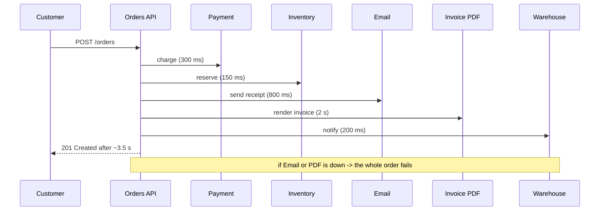
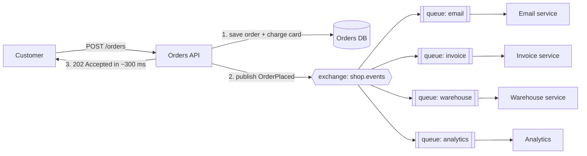
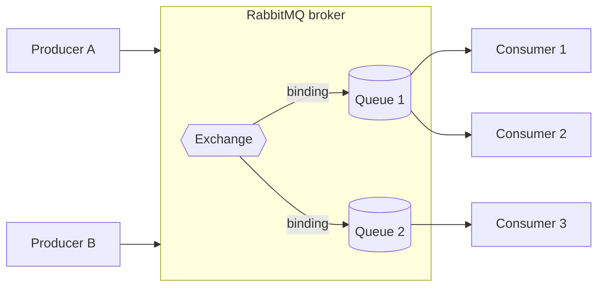
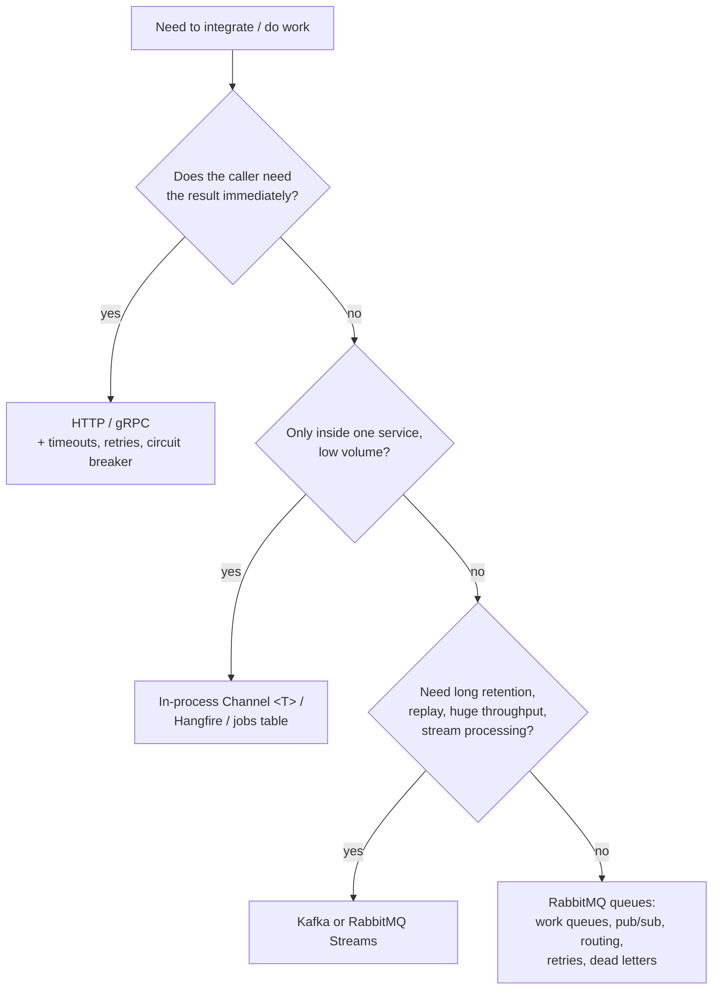

# 01 · Why messaging? Traditional integration vs a message broker

> What problem RabbitMQ solves, the traditional ways teams integrate systems, why those break at scale, and a
> clear checklist for **when to use RabbitMQ and when not to**.

---

## 1. The problem in one picture

An online shop. When a customer places an order the system must: save the order, charge the card, reserve stock,
email a receipt, generate an invoice PDF, notify the warehouse and update analytics.

### Traditional way: one synchronous chain



What goes wrong:

| Problem | Why it happens |
|---------|----------------|
| **Latency adds up** | the customer waits for the sum of every call (3.5 s above) |
| **Temporal coupling** | every service must be **up at the same time**; one is down → the order fails |
| **Cascading failure** | a slow email server holds threads in the API, the API slows down, the load balancer times out |
| **Load spikes** | Black Friday: 10× traffic hits every downstream service at the same instant |
| **Tight coupling** | adding "send SMS" means changing and redeploying the Orders API |
| **Retries are hard** | if the PDF call fails after the card was charged, what now? |

### With a broker: do the critical part now, everything else asynchronously



* The customer gets an answer as soon as the **critical** work is done.
* If the email service is down, messages **wait in its queue** and are delivered when it comes back.
* Adding SMS = a new queue bound to the same exchange. **The Orders API does not change.**
* A spike fills queues; consumers work through them at their own pace (**load levelling**).

---

## 2. Traditional ways to integrate (and their limits)

| Approach | How it works | Good for | Breaks when |
|----------|-------------|----------|-------------|
| **Synchronous HTTP / gRPC** | service A calls service B and waits | queries that need an answer now (get price, check stock) | B is slow/down, long chains, fan-out to many services, spikes |
| **Shared database** | A writes rows, B reads the same tables | small monoliths | schema becomes a public contract, locking, no notifications, every team blocked by one DB |
| **Database polling ("jobs" table)** | A inserts a row, B runs `SELECT ... WHERE processed = 0` every N seconds | a few jobs per minute, single consumer | many consumers (double processing, `SELECT FOR UPDATE SKIP LOCKED` gymnastics), latency = poll interval, DB load, no fan-out |
| **Files + FTP + cron** | export CSV at night, partner imports it | legacy batch integration | hours of latency, partial files, no per-record retry |
| **In-process background work** (`Task.Run`, `Channel<T>`, `IHostedService`, Hangfire) | queue inside your own process or DB | work that belongs to one service | process restarts lose in-memory work, can't fan out to other services, scaling one instance ≠ scaling the work |
| **Webhooks** | A calls B's URL when something happens | external partners | B down → A must retry and store, no back-pressure |
| **Message broker (RabbitMQ)** | A publishes to the broker, the broker stores and routes, B consumes | async work, events, fan-out, spikes, decoupling | you need an immediate answer, or long-term replay of history (→ Kafka/streams) |

### Example: the "jobs table" vs a queue

```csharp
// Traditional polling worker
while (!stoppingToken.IsCancellationRequested)
{
    var jobs = await db.EmailJobs
        .Where(j => j.ProcessedUtc == null)
        .OrderBy(j => j.Id)
        .Take(50)
        .ToListAsync(stoppingToken);       // runs every 5 s even when the table is empty

    foreach (var job in jobs) { await Send(job); job.ProcessedUtc = DateTime.UtcNow; }
    await db.SaveChangesAsync(stoppingToken);
    await Task.Delay(TimeSpan.FromSeconds(5), stoppingToken);
}
```

Problems: two instances pick the same rows, latency up to 5 s, the table grows forever, constant DB queries.

```csharp
// RabbitMQ consumer: the broker pushes, competing consumers never get the same message
consumer.ReceivedAsync += async (_, delivery) =>
{
    await Send(Json.Deserialize<EmailJob>(delivery.Body));
    await channel.BasicAckAsync(delivery.DeliveryTag, multiple: false);
};
await channel.BasicConsumeAsync("email.jobs", autoAck: false, consumer);
```

> The jobs table is not wrong. It is the right tool for a few jobs inside one service, and it is the base of the
> **transactional outbox** (doc 09). It just should not be your cross-service messaging system.

---

## 3. What a message broker gives you



| Capability | Meaning |
|-----------|---------|
| **Decoupling in time** | producer and consumer don't need to be online together |
| **Decoupling in space** | the producer doesn't know who consumes, or how many consumers there are |
| **Load levelling** | queues absorb spikes, consumers process at a steady rate |
| **Scaling out** | add consumers on the same queue (competing consumers) |
| **Fan-out** | one event → many independent services |
| **Routing** | deliver by key, pattern or headers |
| **Reliability** | durable queues, persistent messages, acknowledgements, publisher confirms |
| **Failure handling** | redelivery, dead-letter exchanges, delayed retry, poison-message limits |
| **Back-pressure** | prefetch, max-length, flow control |

---

## 4. When to use RabbitMQ

✅ **Use it when**

1. **Work can happen later**: emails, PDFs, thumbnails, reports, notifications, exports.
2. **One event has many interested services**: `OrderPlaced` → billing, email, warehouse, analytics.
3. **You need to absorb spikes**: flash sales, IoT bursts, nightly imports.
4. **You need to distribute work across many workers**: image processing, video transcoding, scraping.
5. **Services must keep working while others are down** (resilience, maintenance windows).
6. **Smart routing**: by region, priority, tenant or type (topic/headers exchanges).
7. **Per-message acknowledgement and retry** is important (payments, orders).
8. **Request/reply between services** where the caller tolerates async behaviour (RPC with timeouts).
9. **Integration across languages**: AMQP clients exist for .NET, Java, Go, Python, Node, ...

❌ **Don't use it when**

1. **The user needs the answer right now** (`GET /price`, login, validate a coupon): use HTTP/gRPC.
2. **It's a simple CRUD app with one service**: an in-process `Channel<T>` or Hangfire is simpler.
3. **You need to replay months of history or do event sourcing / stream processing** at very high throughput:
   Kafka (or RabbitMQ **streams**, doc 06) fits better.
4. **You need strict global ordering across many consumers**: queues guarantee order per queue with a single
   consumer only.
5. **Large payloads** (videos, big files): store the file in blob storage and send a reference (claim check).
6. **You use the broker as a database**: long-lived millions of messages, querying messages. Keep queues short.
7. **The team can't operate it** and a managed cloud queue (Azure Service Bus, Amazon SQS) is available.



---

## 5. Real-world examples

| Domain | Producer | Message | Consumers |
|--------|----------|---------|-----------|
| E-commerce | Orders API | `OrderPlaced` | email, invoice, warehouse, loyalty points, analytics |
| Fleet / logistics | GPS gateway | `VehiclePositionReported` (thousands/s) | live map, geofence alerts, trip history |
| Banking | Transfers service | `TransferRequested` | fraud check → ledger → notification |
| Media | Upload API | `VideoUploaded` | transcoders (competing workers), thumbnail generator |
| SaaS | Billing | `InvoiceDue` (priority queue) | email/SMS reminders, dunning |
| Healthcare | Lab system | `LabResultReady` | doctor notification, patient portal, archive |
| IoT / factory | MQTT devices | sensor readings (MQTT plugin) | alarms, dashboards, storage |

---

## 6. Key vocabulary (details in doc 02)

* **Producer / publisher**: sends messages.
* **Consumer / subscriber**: receives messages.
* **Broker**: the RabbitMQ server.
* **Exchange**: receives messages from producers and **routes** them.
* **Queue**: stores messages until a consumer takes them.
* **Binding**: rule that connects an exchange to a queue (with a key/pattern/headers).
* **Routing key**: label on the message the exchange uses to route.
* **Ack**: the consumer tells the broker "done, delete it".

➡️ Next: [02 · Core concepts and the AMQP model](02-core-concepts.md)
