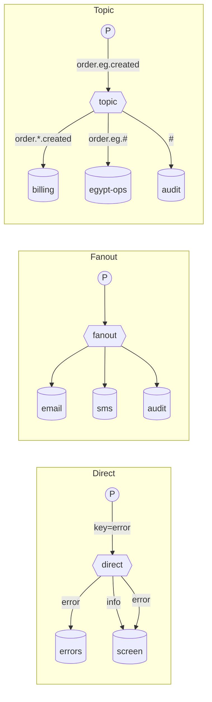
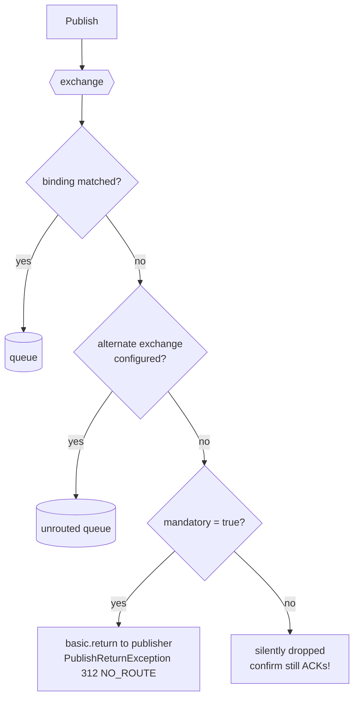
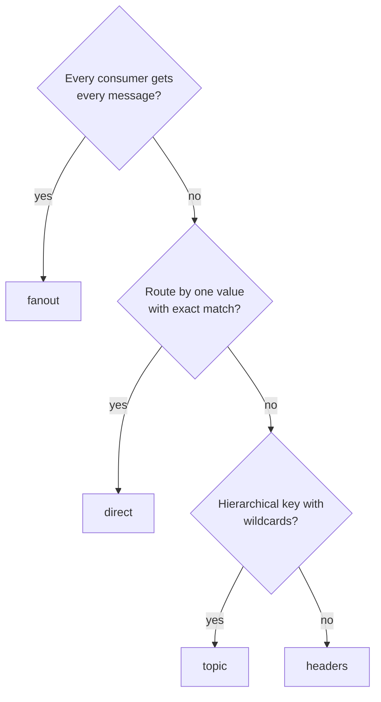

# 03 · Exchanges and routing

> The five ways RabbitMQ routes a message (default, direct, fanout, topic, headers), exchange-to-exchange
> bindings, alternate exchanges, and how to choose.

Samples: [01](../samples/01-HelloWorld) default · [03](../samples/03-PublishSubscribe) fanout ·
[04](../samples/04-Routing) direct · [05](../samples/05-Topics) topic · [06](../samples/06-Headers) headers ·
[08](../samples/08-PublisherConfirms) alternate exchange. Tests: `RoutingTests`.

---

## 1. Overview

| Type | Routes by | Typical use | Cost |
|------|-----------|-------------|------|
| **Default** (`""`) | queue name = routing key | point-to-point, tutorials, RPC replies | fastest |
| **Direct** | exact routing key | severity levels, command per service, tenant id | fast (hash lookup) |
| **Fanout** | ignores the key, copies to **all** bound queues | broadcast, pub/sub, cache invalidation | fast |
| **Topic** | key **pattern** with `*` and `#` | events `order.eg.created`, multi-dimensional routing | a bit slower (trie) |
| **Headers** | message **headers** (`x-match` all/any) | routing on several attributes not suited to a key | slowest, rarely needed |



A message that matches **several** bindings of the **same** queue is delivered to that queue **once**. A message
that matches **no** binding is **dropped** silently, unless you use `mandatory` or an alternate exchange.

---

## 2. Default exchange

Every queue is automatically bound to the nameless direct exchange `""` with its own name as the key.

```csharp
await channel.QueueDeclareAsync("hello", durable: true, exclusive: false, autoDelete: false);
await channel.BasicPublishAsync(exchange: "", routingKey: "hello", body: body);
```

Simple, but the producer now knows the queue name (coupling). Prefer a named exchange for events.

## 3. Direct exchange

```csharp
await channel.ExchangeDeclareAsync("logs.direct", ExchangeType.Direct, durable: true);
await channel.QueueBindAsync(screenQueue, "logs.direct", "info");
await channel.QueueBindAsync(screenQueue, "logs.direct", "warning");
await channel.QueueBindAsync(screenQueue, "logs.direct", "error");
await channel.QueueBindAsync(diskQueue,   "logs.direct", "error");

await channel.BasicPublishAsync("logs.direct", routingKey: "error", body: body);   // -> both queues
```

Several queues may use the same binding key (then direct behaves like fanout for that key).

## 4. Fanout exchange (publish/subscribe)

```csharp
await channel.ExchangeDeclareAsync("logs", ExchangeType.Fanout, durable: true);

var temp = await channel.QueueDeclareAsync(queue: "", durable: false, exclusive: true, autoDelete: true);
await channel.QueueBindAsync(temp.QueueName, "logs", routingKey: "");
```

* Each **subscriber has its own queue**. Every queue gets a copy.
* **Temporary** subscribers (live dashboards) use server-named exclusive queues; **services** that must not miss
  events use **durable named queues** (`email.order-placed`).
* Messages published while no queue is bound are lost: sample 03 shows it.

## 5. Topic exchange

Routing keys are words separated by dots: `<entity>.<region>.<event>`.

| Wildcard | Means |
|----------|-------|
| `*` | exactly **one** word |
| `#` | **zero or more** words |

| Binding | `order.eg.created` | `order.sa.created` | `order.eg.payment.failed` | `inventory.low-stock` |
|---------|:-:|:-:|:-:|:-:|
| `order.*.created` | ✅ | ✅ | ❌ | ❌ |
| `order.eg.#` | ✅ | ❌ | ✅ | ❌ |
| `#.failed` | ❌ | ❌ | ✅ | ❌ |
| `*.failed` | ❌ | ❌ | ❌ | ❌ |
| `#` | ✅ | ✅ | ✅ | ✅ |

* Binding `#` = fanout, binding without wildcards = direct.
* Design keys from **general to specific** and keep the number of words consistent per message type.
* Topic is the usual choice for **domain events** because new consumers can subscribe at any granularity.

## 6. Headers exchange

Routes on header values; the routing key is ignored.

```csharp
await channel.QueueBindAsync("documents.pdf-reports", "documents.headers", "", new Dictionary<string, object?>
{
    ["x-match"] = "all",          // all | any | all-with-x | any-with-x
    ["format"] = "pdf",
    ["type"] = "report"
});

var props = new BasicProperties { Headers = new Dictionary<string, object?> { ["format"] = "pdf", ["type"] = "report" } };
```

* `all`: every binding header must match. `any`: at least one. The `-with-x` variants also compare headers that
  start with `x-`.
* String header values arrive at the consumer as `byte[]`: decode with `Encoding.UTF8.GetString`.
* Use it when the routing criteria don't form a natural hierarchy. Otherwise a topic key is simpler and faster.

## 7. Exchange-to-exchange bindings

```csharp
await channel.ExchangeBindAsync(destination: "analytics", source: "shop.events", routingKey: "order.#");
```

Build routing trees: one public `shop.events` exchange, internal exchanges per team. An exchange declared with
`internal: true` cannot be published to by clients, only by other exchanges.

## 8. Unroutable messages: mandatory, returns and alternate exchanges



```csharp
await channel.ExchangeDeclareAsync("orders", ExchangeType.Direct, durable: true,
    arguments: new Dictionary<string, object?> { ["alternate-exchange"] = "orders.unrouted" });
```

> A publisher confirm only means "the broker took responsibility". An unroutable message without `mandatory` is
> **confirmed and then dropped**. Use `mandatory: true` or an alternate exchange for important messages.

## 9. Which exchange should I use?



## 10. Naming conventions

* Exchanges: `<domain>.<purpose>` → `shop.events`, `billing.commands`, `shop.dead-letter`.
* Queues: `<consumer-service>.<what>` → `email.order-placed`, `warehouse.orders`.
* Routing keys for events: `<entity>.<event>` or `<entity>.<context>.<event>` in past tense: `order.placed`.
* Commands (one handler) usually go to a direct exchange or a queue; events (many listeners) to topic/fanout.

➡️ Next: [04 · Consumers, acknowledgements and prefetch](04-consumers-acks-prefetch.md)
