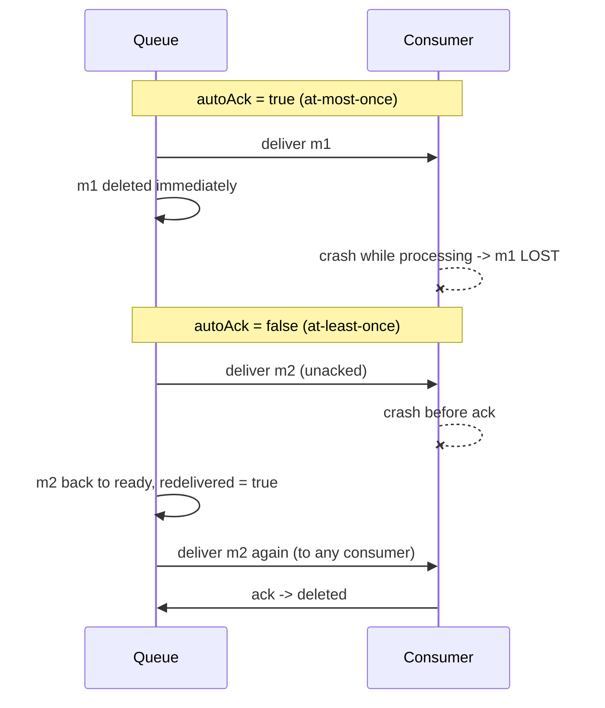
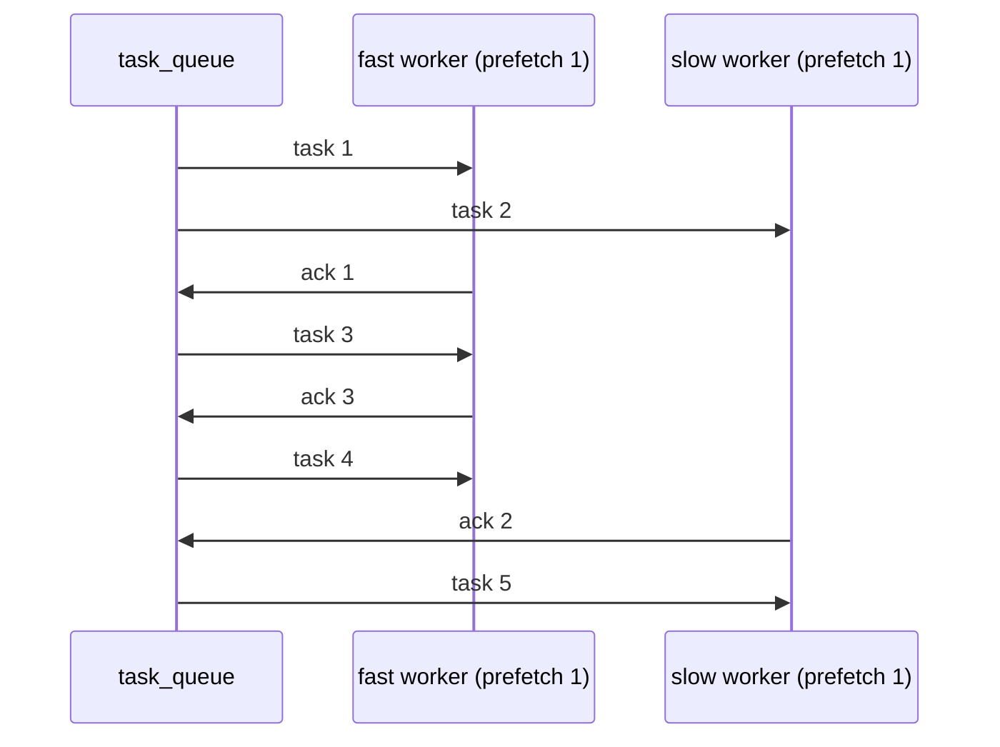
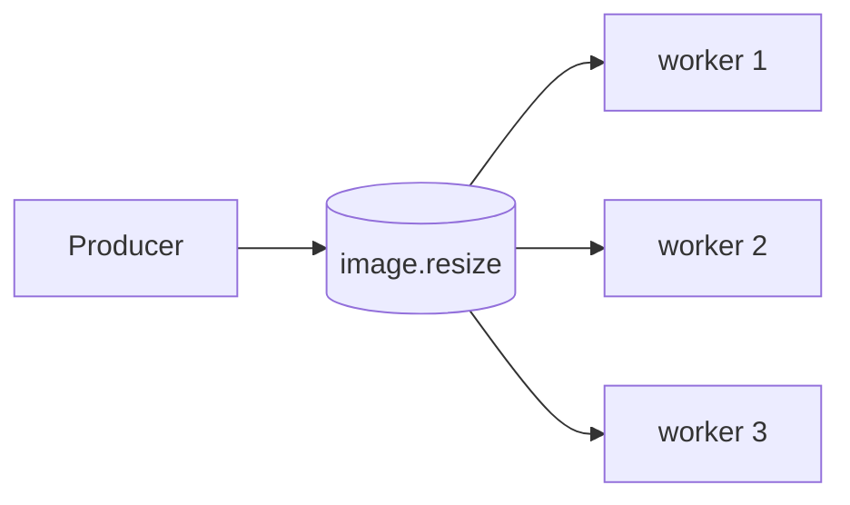
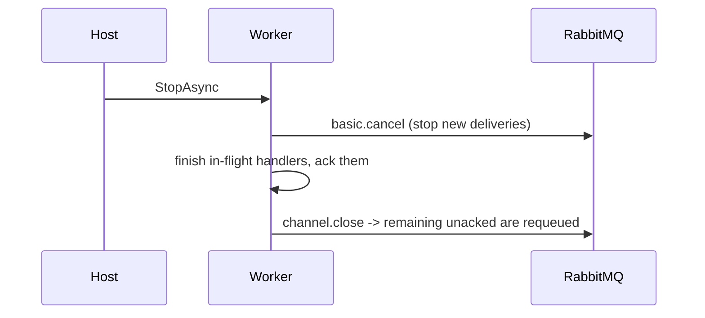

# 04 · Consumers, acknowledgements and prefetch

> Push vs pull, automatic vs manual acknowledgements, ack / nack / reject, redelivery, prefetch (QoS) and fair
> dispatch, competing consumers, ordering, concurrency, single active consumer and graceful shutdown.

Samples: [02-WorkQueues](../samples/02-WorkQueues), [10-QueueFeatures](../samples/10-QueueFeatures),
[13-OrdersApi](../samples/13-OrdersApi). Tests: `AcknowledgementTests`.

---

## 1. Push (consume) vs pull (get)

| | `BasicConsumeAsync` (push) | `BasicGetAsync` (pull) |
|-|---------------------------|------------------------|
| How | broker pushes messages as they arrive | you ask for one message |
| Efficiency | high, batching with prefetch | one round trip per message |
| Use | **always in production consumers** | tests, admin tools, "peek one" |

```csharp
var consumer = new AsyncEventingBasicConsumer(channel);
consumer.ReceivedAsync += async (sender, delivery) =>
{
    var body = delivery.Body.ToArray();               // copy if you keep it after the handler returns
    await HandleAsync(body);
    await channel.BasicAckAsync(delivery.DeliveryTag, multiple: false);
};
string consumerTag = await channel.BasicConsumeAsync("task_queue", autoAck: false, consumer: consumer);
```

`delivery` carries: `DeliveryTag` (per-channel sequence number), `Redelivered`, `Exchange`, `RoutingKey`,
`BasicProperties` and `Body`. The `Body` memory is only valid **during** the handler.

## 2. Acknowledgement modes



| Mode | Guarantee | When |
|------|-----------|------|
| `autoAck: true` | at-most-once, a crash loses in-flight messages | metrics, live dashboards, logs you can lose |
| `autoAck: false` + ack after work | at-least-once, duplicates possible | **default for business messages** |

> Ack **after** the work is done (and after the DB transaction committed), never before.

## 3. Ack, nack, reject

| Call | Effect |
|------|--------|
| `BasicAckAsync(tag, multiple: false)` | done, delete the message |
| `BasicAckAsync(tag, multiple: true)` | ack this and **all earlier** unacked tags on the channel (batch ack) |
| `BasicNackAsync(tag, multiple, requeue: true)` | put it back in the queue (at its original position when possible) |
| `BasicNackAsync(tag, multiple, requeue: false)` | drop it, or **dead-letter** it if the queue has a DLX |
| `BasicRejectAsync(tag, requeue)` | like nack but for one message (AMQP standard) |
| Channel/connection closes | every unacked message is requeued with `redelivered = true` |

* ⚠️ `requeue: true` on a message that always fails = **infinite hot loop** (poison message). Use dead-lettering,
  a delayed retry or the quorum `x-delivery-limit` (doc 07).
* ⚠️ Forgetting to ack: messages stay "unacked" forever, the consumer stops receiving once prefetch is full, and
  memory grows. RabbitMQ 4 closes the channel after `consumer_timeout` (30 min default) with `PRECONDITION_FAILED`.
* ⚠️ Acking with the wrong channel or twice → channel error `406 PRECONDITION_FAILED - unknown delivery tag`.
  Delivery tags are **per channel**.

## 4. Prefetch (QoS) and fair dispatch

Without a prefetch limit, the broker sends **all** ready messages to consumers as fast as possible, round-robin.
A slow consumer ends up with a huge private backlog while a fast one sits idle.

```csharp
await channel.BasicQosAsync(prefetchSize: 0, prefetchCount: 1, global: false);
```



Sample 02 output: the fast worker completed 10 tasks, the slow one 2.

| prefetch | Effect |
|----------|--------|
| 1 | perfectly fair, lowest throughput (one round trip per message), good for long tasks |
| 10–300 | typical for fast handlers, keeps the pipe full |
| 0 (unlimited) | never in production consumers |

Rule of thumb: start with **prefetch ≈ number of messages processed concurrently × 2** and measure.
`global: true` is per-channel on classic queues and is **not supported** by quorum queues; keep `false`.

## 5. Competing consumers (scaling out)

Several consumers on **one queue** = each message goes to **one** of them. Run more instances to scale.



Contrast with pub/sub: several **queues**, each with its own consumers, all receiving every message.

## 6. Ordering

* A queue is FIFO. **With one consumer and prefetch 1** you process in publish order (from one publisher on one
  channel).
* Competing consumers, prefetch > 1, concurrency, requeue and retries all **break strict order**.
* Need order per key (per order id, per device)? Use **single active consumer**, a consistent-hash exchange that
  shards keys to queues, or design handlers to tolerate disorder (versions, timestamps). Kafka/streams give
  per-partition order natively.

## 7. Concurrency inside one consumer

By default a channel dispatches **one message at a time** to your handler. In RabbitMQ.Client 7 you can raise it:

```csharp
var channel = await connection.CreateChannelAsync(new CreateChannelOptions(
    publisherConfirmationsEnabled: false,
    publisherConfirmationTrackingEnabled: false,
    consumerDispatchConcurrency: 8));
await channel.BasicQosAsync(0, 16, false);
```

(or `ConnectionFactory.ConsumerDispatchConcurrency` for every channel). Your handler must then be thread-safe and
ordering is no longer guaranteed. Sample 07's RPC server uses 4.

## 8. Single active consumer

```csharp
arguments: new Dictionary<string, object?> { ["x-single-active-consumer"] = true }
```

Many consumers subscribe, the broker delivers to **one**; if it disconnects, the next takes over. Gives ordering
+ high availability (sample 10, test `Single_active_consumer_sends_everything_to_one_consumer`).

## 9. Exclusive consumers, cancel and shutdown

* `exclusive: true` on `BasicConsumeAsync` → nobody else can consume this queue.
* `BasicCancelAsync(consumerTag)` stops deliveries; in-flight messages can still be acked.
* The broker may cancel your consumer (queue deleted, node failed over): handle `consumer.UnregisteredAsync` /
  `ShutdownAsync` and the connection's recovery events.

Graceful shutdown in a hosted service (sample 13):



## 10. Automatic recovery

`AutomaticRecoveryEnabled = true` (default) reconnects after network failures and re-creates channels, QoS,
exchanges, queues, bindings and consumers declared on that connection (`TopologyRecoveryEnabled`). Things it does
**not** do: re-send messages you published while disconnected (use confirms + your own retry/outbox), or recover
after an explicit `CloseAsync`. Subscribe to `connection.ConnectionShutdownAsync`, `RecoverySucceededAsync`,
`ConnectionRecoveryErrorAsync` to log what happens.

## Checklist for a production consumer

- [ ] manual acks, ack after the work is committed
- [ ] prefetch set (not 0)
- [ ] poison messages go to a DLX (no infinite requeue)
- [ ] handler is idempotent (messages can be redelivered)
- [ ] one channel per consumer, long-lived connection
- [ ] graceful shutdown (cancel, finish, close)
- [ ] logs include `MessageId`, `CorrelationId`, `Redelivered`

➡️ Next: [05 · Publisher reliability](05-publisher-reliability.md)
