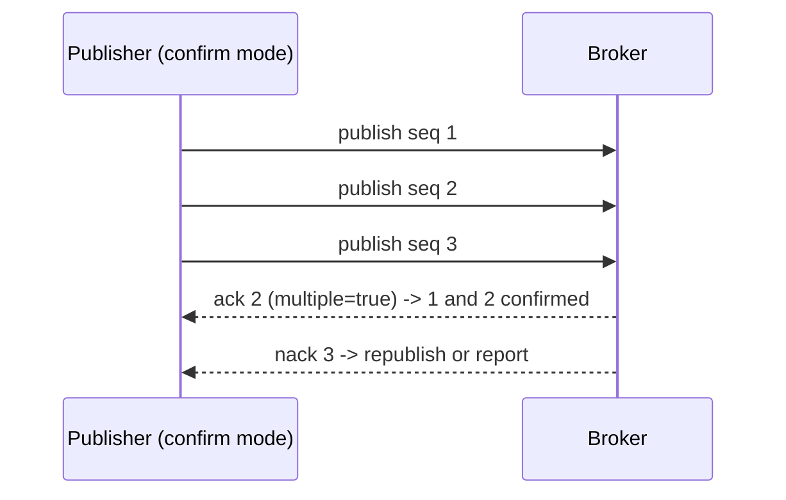

# 05 · Publisher reliability: durability, confirms, returns and flow control

> How not to lose messages on the publishing side: the durability triad, publisher confirms (one by one,
> batched, tracked in RabbitMQ.Client 7), mandatory + returns, alternate exchanges, why transactions are rarely
> used, and what happens when the broker blocks publishers.

Sample: [08-PublisherConfirms](../samples/08-PublisherConfirms). Tests: `RoutingTests`, `QueueFeatureTests`.

---

## 1. Where can a message be lost?


| # | Loss | Fix |
|---|------|-----|
| 1, 2 | publish never reached the broker / not stored | **publisher confirms** + retry (and an outbox for crash safety) |
| 3 | unroutable | `mandatory: true` / alternate exchange |
| 4 | broker restart | **durable** exchange + **durable** queue (quorum) + **persistent** message |
| 5 | consumer crash | manual acks (doc 04) |

## 2. The durability triad

```csharp
await channel.ExchangeDeclareAsync("shop.events", ExchangeType.Topic, durable: true);
await channel.QueueDeclareAsync("email.order-placed", durable: true, exclusive: false, autoDelete: false,
    arguments: new Dictionary<string, object?> { ["x-queue-type"] = "quorum" });
var props = new BasicProperties { Persistent = true };      // delivery-mode = 2
```

Quorum queues always store messages durably and replicate them to several nodes, which is why they are the
recommended type for important data (doc 06).

## 3. Publisher confirms

With confirms on, the broker answers every publish with **ack** (stored / taken responsibility) or **nack**
(could not store, e.g. queue full with `reject-publish`, internal error).



### RabbitMQ.Client 7: tracked confirms

```csharp
var channel = await connection.CreateChannelAsync(new CreateChannelOptions(
    publisherConfirmationsEnabled: true,
    publisherConfirmationTrackingEnabled: true));

try
{
    await channel.BasicPublishAsync("shop.events", "order.placed", mandatory: true, basicProperties: props, body: body);
    // completes only when the broker confirmed
}
catch (PublishReturnException ex)    // unroutable + mandatory: ex.ReplyCode 312 NO_ROUTE
{
}
catch (PublishException ex)          // nacked by the broker (ex.IsReturn == false)
{
}
```

* With tracking enabled, `BasicPublishAsync` **awaits the confirm** and throws on nack/return.
* A rate limiter limits outstanding confirms (default 128) to protect memory; pass your own
  `outstandingPublisherConfirmationsRateLimiter` to change it.
* Without tracking (`publisherConfirmationTrackingEnabled: false`) you get confirm mode but must correlate acks
  yourself through `channel.BasicAcksAsync` / `BasicNacksAsync` events and `GetNextPublishSequenceNumberAsync()`.

### Strategies and their cost (sample 08 on a laptop)

| Strategy | Code | 2 000 messages |
|----------|------|----------------|
| Await each publish | `await channel.BasicPublishAsync(...)` in a loop | ~1 600 ms |
| Batched: start 100 publishes, then await them | collect `ValueTask`s, await the batch | ~60 ms |
| Async handler-based (no tracking) | events + `ConcurrentDictionary<seq, msg>` | fastest, most code |

Batching is ~25× faster because many messages share one disk sync and one network round trip.

## 4. Mandatory flag and returns

```csharp
channel.BasicReturnAsync += (_, ret) =>
{
    logger.LogWarning("Returned {Code} {Text} {Exchange}/{Key}", ret.ReplyCode, ret.ReplyText, ret.Exchange, ret.RoutingKey);
    return Task.CompletedTask;
};
await channel.BasicPublishAsync(exchange, key, mandatory: true, basicProperties: props, body: body);
```

Confirm ≠ routed: without `mandatory`, an unroutable message is **acked and dropped** (test
`Unroutable_message_without_mandatory_is_confirmed_and_silently_dropped`).

## 5. Alternate exchange

Instead of bouncing unroutable messages back, keep them on the broker:

```csharp
await channel.ExchangeDeclareAsync("orders", ExchangeType.Direct, durable: true,
    arguments: new Dictionary<string, object?> { ["alternate-exchange"] = "orders.unrouted" });
```

Useful as a safety net in production and to discover routing bugs.

## 6. Transactions (`TxSelect`) – why almost nobody uses them

`TxSelectAsync / TxCommitAsync / TxRollbackAsync` make a group of publishes/acks atomic on one channel, but they
are synchronous, **~250× slower** than confirms and do not span queues on other nodes or your database. Use
confirms; for "DB change + message" atomicity use the **outbox** (doc 09).

## 7. When the broker pushes back

| Mechanism | Trigger | What the publisher sees |
|-----------|---------|-------------------------|
| **Credit flow** | a queue/connection can't keep up | publishing slows down transparently |
| **Memory alarm** | node uses > `vm_memory_high_watermark` (default 0.6 of RAM) | **all publishing connections are blocked** (`ConnectionBlockedAsync`) until memory drops |
| **Disk alarm** | free disk < `disk_free_limit` | same, publishers blocked |
| **Max length + reject-publish** | queue full | nack → `PublishException` |

```csharp
connection.ConnectionBlockedAsync += (_, e) => { logger.LogError("Blocked: {Reason}", e.Reason); return Task.CompletedTask; };
connection.ConnectionUnblockedAsync += (_, _) => { logger.LogInformation("Unblocked"); return Task.CompletedTask; };
```

Consequences: a publisher shared with consumers on the same connection can block your consumers too → use
separate connections for publishing and consuming in busy services. Always publish with a timeout /
cancellation token so HTTP requests don't hang forever.

## 8. Retrying publishes

* Retry on nack, on `AlreadyClosedException` / connection loss (after recovery), with backoff.
* Retrying can produce **duplicates** (the first publish may have been stored but the confirm was lost) → give
  every message a stable `MessageId` and make consumers idempotent.
* A process crash between "save to DB" and "publish" loses the event → **transactional outbox** (doc 09,
  sample 12).

## Checklist for a production publisher

- [ ] durable exchange + durable/quorum queue + `Persistent = true`
- [ ] publisher confirms with tracking, batched where throughput matters
- [ ] `mandatory: true` or an alternate exchange for business messages
- [ ] `MessageId`, `Type`, `ContentType`, `Timestamp`, `CorrelationId` set
- [ ] long-lived connection + channel, not one per message
- [ ] handle blocked connections and publish with a cancellation token
- [ ] outbox when the message must match a database change

➡️ Next: [06 · Queue types and arguments](06-queue-types-and-arguments.md)
