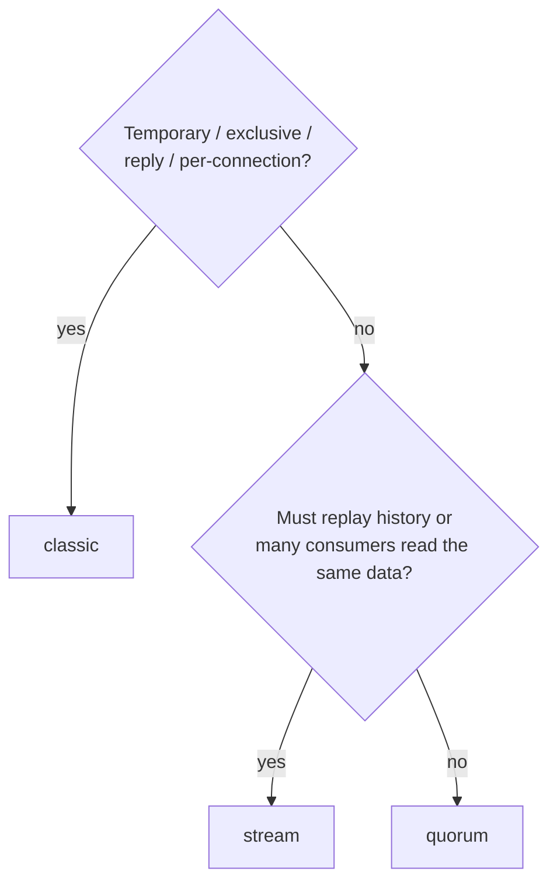

# 06 · Queue types and queue arguments

> Classic vs quorum vs stream queues, every important `x-` argument (TTL, expiry, length limits, overflow,
> dead-lettering, priority, single active consumer, delivery limit), and arguments vs policies.

Samples: [09](../samples/09-DeadLetterRetry), [10-QueueFeatures](../samples/10-QueueFeatures),
[11-Streams](../samples/11-Streams). Tests: `QueueFeatureTests`, `DeadLetterTests`.

---

## 1. Three queue types

| | **Classic** | **Quorum** | **Stream** |
|-|-------------|-----------|-----------|
| Declare | default / `x-queue-type: classic` | `x-queue-type: quorum` | `x-queue-type: stream` |
| Replication | none (single node) in RabbitMQ 4 | Raft, replicated to an odd number of nodes | replicated log |
| Durability | durable or transient | always durable | always durable |
| Consume semantics | destructive (ack deletes) | destructive | **non-destructive**, read from any offset |
| Exclusive / auto-delete | ✅ | ❌ | ❌ |
| Priority | up to 255 levels (`x-max-priority`) | 2 levels (high ≥ 5 / normal) | ❌ |
| Poison-message limit | ❌ | ✅ `x-delivery-limit` (default 20 in 4.x) | n/a |
| Best for | temporary/reply/exclusive queues, non-critical data | **business messages: orders, payments, commands** | event log, replay, fan-out to many readers, huge backlogs |

Classic mirrored queues were **removed in RabbitMQ 4.0**; use quorum queues for high availability.



### Quorum queues

```csharp
await channel.QueueDeclareAsync("payments.process", durable: true, exclusive: false, autoDelete: false,
    arguments: new Dictionary<string, object?>
    {
        ["x-queue-type"] = "quorum",
        ["x-delivery-limit"] = 5,
        ["x-dead-letter-exchange"] = "payments.dlx"
    });
```

* A leader plus followers; a write is confirmed once a majority stored it. Survives the loss of a minority of
  nodes (3 nodes → tolerate 1 failure, 5 → 2).
* Every redelivery increments `x-delivery-count`; above `x-delivery-limit` the message is dead-lettered with
  reason `delivery_limit` (or dropped without a DLX). This kills poison-message loops.
* Optional `x-dead-letter-strategy: at-least-once` (with `x-overflow: reject-publish`) makes dead-lettering
  itself safe.

### Streams

```csharp
await channel.QueueDeclareAsync("events.stream", durable: true, exclusive: false, autoDelete: false,
    arguments: new Dictionary<string, object?>
    {
        ["x-queue-type"] = "stream",
        ["x-max-age"] = "7D",                    // retention by time (Y, M, D, h, m, s)
        ["x-max-length-bytes"] = 20_000_000_000  // retention by size
    });

await channel.BasicQosAsync(0, 100, false);       // required for stream consumers
await channel.BasicConsumeAsync("events.stream", autoAck: false, consumerTag: "", noLocal: false, exclusive: false,
    arguments: new Dictionary<string, object?> { ["x-stream-offset"] = "first" },   // first | last | next | long offset | timestamp | "10m"
    consumer: consumer);
```

* Messages are **appended**; acks only give credit, they don't delete. Many consumers can read the same data at
  their own position. Retention removes old segments.
* Read from AMQP 0-9-1 (above) or, for very high throughput, the **stream protocol** with `RabbitMQ.Stream.Client`
  (port 5552), which adds producer de-duplication, offset tracking on the server and super streams
  (partitioning).
* Sample 11: reporting replays from `first`, analytics starts at offset 5, a live dashboard reads `next`.

## 2. Queue arguments reference

| Argument | Type | Effect | Queue types |
|----------|------|--------|-------------|
| `x-queue-type` | string | `classic` / `quorum` / `stream` | all |
| `x-message-ttl` | int ms | messages older than this expire (dead-letter reason `expired`) | classic, quorum |
| `x-expires` | int ms | delete the **queue** after it has been unused this long | classic, quorum |
| `x-max-length` | int | max number of ready messages | classic, quorum |
| `x-max-length-bytes` | long | max total body size | all |
| `x-overflow` | string | `drop-head` (default, drop/dead-letter oldest), `reject-publish` (nack new), `reject-publish-dlx` (classic) | classic, quorum |
| `x-dead-letter-exchange` | string | where expired/rejected/overflowed messages go | classic, quorum |
| `x-dead-letter-routing-key` | string | replace the routing key when dead-lettering | classic, quorum |
| `x-max-priority` | int | enable priorities (use ≤ 10) | classic |
| `x-single-active-consumer` | bool | only one consumer receives at a time | classic, quorum |
| `x-delivery-limit` | int | max redeliveries before dead-lettering | quorum |
| `x-queue-leader-locator` | string | `client-local` / `balanced` placement of the leader | quorum, stream |
| `x-max-age` | string | stream retention by time | stream |

Per-message TTL: `BasicProperties.Expiration = "5000"` (string, ms). The **lower** of queue TTL and message TTL
wins. In classic queues an expired message is only removed when it reaches the head of the queue.

### Examples from sample 10

```text
ttl         x-message-ttl = 1000: right away 1 message, after 1.5s 0
max-length  x-max-length = 3, drop-head: published 1..5, kept 3, 4, 5
max-length  x-max-length = 2, reject-publish: job 3 nacked -> apply back-pressure
priority    published 1, 9, 5, 0 -> delivered 9 > 5 > 1 > 0
x-expires   unused queue deleted itself -> passive declare 404 NOT_FOUND
quorum      x-delivery-limit = 2: delivered 3 times, then dead-lettered
sac         primary processed 1-3, primary leaves, standby processed 4-6
```

## 3. Arguments vs policies

Arguments are fixed at declaration: changing them later gives `406 PRECONDITION_FAILED` (test
`Redeclaring_a_queue_with_different_arguments_fails_with_406_and_closes_the_channel`) and you must delete and
recreate the queue. **Policies** are set by operators on the broker and apply to queues matching a regex, and can
be changed at runtime:

```bash
rabbitmqctl set_policy payments-dlx "^payments\." \
  '{"dead-letter-exchange":"payments.dlx","delivery-limit":5}' --apply-to queues
```

Recommended: put **behaviour that operators tune** (TTL, length limits, DLX, delivery limit) in policies, and
what the code depends on (queue type, exclusive, durable) in code. RabbitMQ 4 also has **operator policies** that
cap what users can set.

## 4. Exclusive, auto-delete and server-named queues

| Kind | Declare | Lifetime | Use |
|------|---------|----------|-----|
| Exclusive | `exclusive: true` | dies with its connection; other connections get `405 RESOURCE_LOCKED` | RPC reply queues, private subscriptions |
| Auto-delete | `autoDelete: true` | deleted when its last consumer leaves | temporary subscriber |
| Server-named | `queue: ""` | `amq.gen-...` name chosen by the broker | combine with exclusive |

## 5. Sizing guidance

* Queues should be **short** most of the time. Millions of waiting messages = consumers too slow; scale
  consumers, add limits, or use a stream.
* Don't create a queue per user/entity unbounded; thousands of queues is fine, millions are not.
* Keep messages small (KBs). Large files → blob storage + reference (**claim check**).

➡️ Next: [07 · Errors, dead-lettering and retries](07-errors-dead-letter-retry.md)
