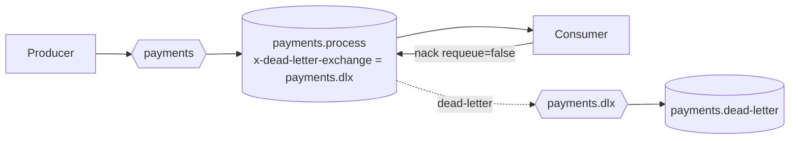
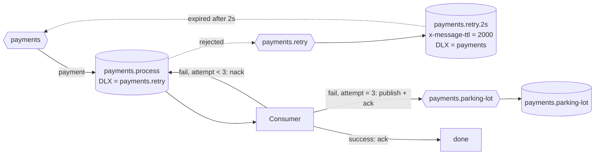
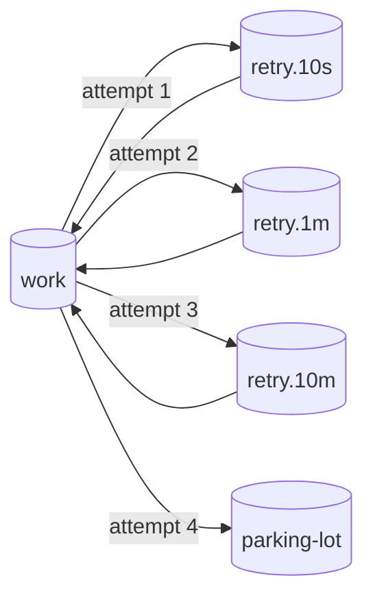

# 07 · Errors, dead-lettering and retries

> Kinds of failures, dead letter exchanges (DLX) and the `x-death` header, retry strategies (immediate, delayed
> with TTL queues, exponential tiers), poison messages, parking lots, and how to replay.

Sample: [09-DeadLetterRetry](../samples/09-DeadLetterRetry). Tests: `DeadLetterTests`.

---

## 1. Classify the failure first

| Failure | Example | Right reaction |
|---------|---------|----------------|
| **Transient** | timeout, 503, deadlock, broker failover | retry later (with delay) |
| **Permanent / poison** | invalid JSON, unknown type, validation error, business rule ("card stolen") | don't retry: dead-letter / park, alert, fix |
| **Bug in the consumer** | `NullReferenceException` | retry won't help; park it, fix, then replay |
| **Downstream outage** | DB down for 10 minutes | pause consumption / circuit breaker, long delays |

## 2. Dead letter exchange (DLX)

A queue with `x-dead-letter-exchange` republishes a message to that exchange when it is:

| Reason in `x-death` | Cause |
|---------------------|-------|
| `rejected` | `BasicNack`/`BasicReject` with `requeue: false` |
| `expired` | message TTL passed |
| `maxlen` | pushed out by `x-max-length` / bytes with `drop-head` |
| `delivery_limit` | quorum queue redelivered more than `x-delivery-limit` |



The dead-lettered message keeps its body and properties and gains an **`x-death`** header (array of tables):

```text
x-death = [{ count=2, reason=rejected, queue=payments.process, exchange=payments,
             routing-keys=[payment], time=... }, { count=2, reason=expired, queue=payments.retry.2s, ... }]
x-first-death-queue / x-first-death-reason / x-first-death-exchange
x-last-death-queue  / x-last-death-reason
```

Read it in C# (`samples/Shared/MessageHeaders.cs`):

```csharp
public static long DeathCount(IReadOnlyBasicProperties properties, string queue, string? reason = null)
{
    if (properties.Headers?.TryGetValue("x-death", out var raw) != true || raw is not IList<object?> deaths) return 0;
    return deaths.OfType<IDictionary<string, object?>>()
        .Where(d => AsString(d["queue"]) == queue && (reason is null || AsString(d["reason"]) == reason))
        .Sum(d => d["count"] is long c ? c : 0);
}
```

## 3. Retry strategies

### a) Immediate requeue – avoid

`BasicNack(requeue: true)` puts the message straight back. A poison message loops thousands of times per second,
burns CPU and blocks the queue. Only acceptable with a quorum queue `x-delivery-limit` as a safety net.

### b) In-process retry

Retry a few times inside the handler (Polly) before acking/nacking. Good for very short blips (100–500 ms).
Holds the message and the prefetch slot meanwhile.

```csharp
var pipeline = new ResiliencePipelineBuilder()
    .AddRetry(new RetryStrategyOptions { MaxRetryAttempts = 3, Delay = TimeSpan.FromMilliseconds(200), BackoffType = DelayBackoffType.Exponential })
    .Build();
await pipeline.ExecuteAsync(async ct => await gateway.ChargeAsync(payment, ct));
```

### c) Delayed retry with a TTL queue + DLX (broker-side, recommended)



Sample 09 output:

```text
pay-1 attempt 1 succeeded -> ack
pay-2 attempt 1 failed (gateway timeout) -> nack, retry in 2s
pay-3 attempt 1 failed (card rejected)   -> nack, retry in 2s
pay-2 attempt 2 failed                   -> nack, retry in 2s
pay-3 attempt 2 failed                   -> nack, retry in 2s
pay-2 attempt 3 succeeded -> ack
pay-3 attempt 3 failed                   -> moved to parking lot (x-error, x-attempts headers)
```

Key points:

* Nobody consumes the retry queue; TTL expiry is the timer.
* The attempt number comes from `x-death` (`count` for the work queue with reason `rejected`) or from your own
  header (`x-retry-count`) if you republish instead of nacking.
* All messages in one retry queue share one delay. Classic queues only expire the **head**, so don't mix
  per-message expirations in one retry queue.

### d) Exponential tiers



The consumer republishes to the tier for the next attempt (direct exchange `retry` with keys `10s`, `1m`, `10m`),
then acks the original. Each tier queue dead-letters back to the work exchange.

### e) Delayed message plugin

`rabbitmq_delayed_message_exchange` adds an `x-delayed-message` exchange with a per-message `x-delay` header. It is
convenient but stores delayed messages on one node without replication and is **not recommended for large
volumes or critical data**; the TTL + DLX approach uses ordinary replicated quorum queues.

## 4. Poison messages and parking lots

* A **parking lot** (a.k.a. error queue) holds messages that exhausted retries. Nobody consumes it
  automatically. Alert on its depth.
* Add diagnostic headers when parking: `x-error`, `x-exception-type`, `x-attempts`, `x-original-queue`,
  `x-failed-at`.
* **Replay** after a fix: shovel the parking lot back to the work exchange (management UI "Move messages" with
  the shovel plugin, `rabbitmqadmin`, or a small replay tool that consumes and republishes).

## 5. Validation errors

Deserialize and validate **first**. If the message is malformed, `BasicReject(requeue: false)` straight to the
DLX (no retry can fix bad JSON). Sample 13's worker separates `JsonException` (dead-letter) from other exceptions
(requeue with a delivery limit).

## 6. Circuit breaking a consumer

If the database is down, every message will fail and burn its retries. Options: stop consuming
(`BasicCancelAsync`) and resume later, lower prefetch, or let a health check take the instance out. MassTransit
has `UseKillSwitch` / circuit breaker filters for this.

## Checklist

- [ ] every business queue has a DLX (by policy is easiest)
- [ ] transient errors get delayed retries with a max attempt count
- [ ] permanent errors skip retries
- [ ] parking lot with alerting and a replay procedure
- [ ] quorum `x-delivery-limit` as the last safety net
- [ ] handlers idempotent, because retries mean duplicates

➡️ Next: [08 · Messaging patterns](08-messaging-patterns.md)
