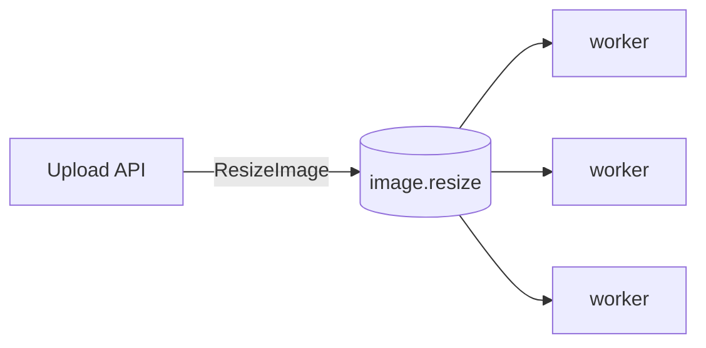
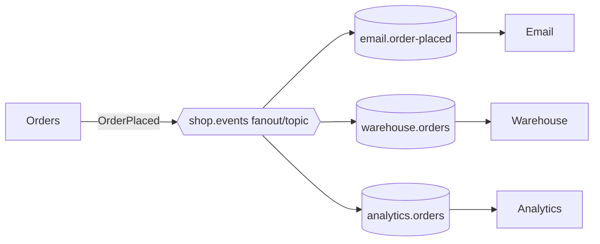
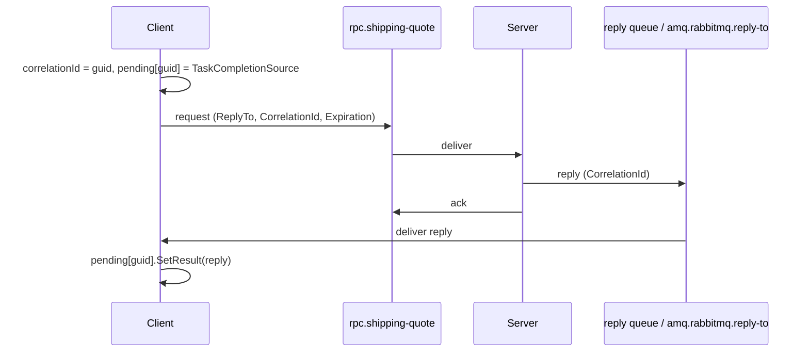
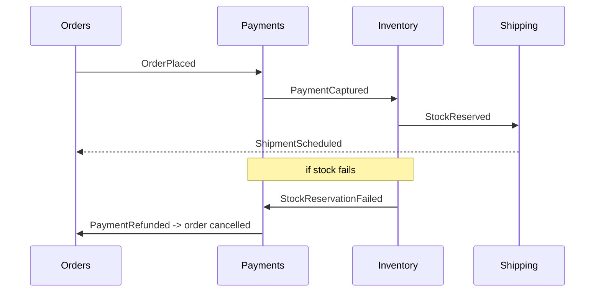
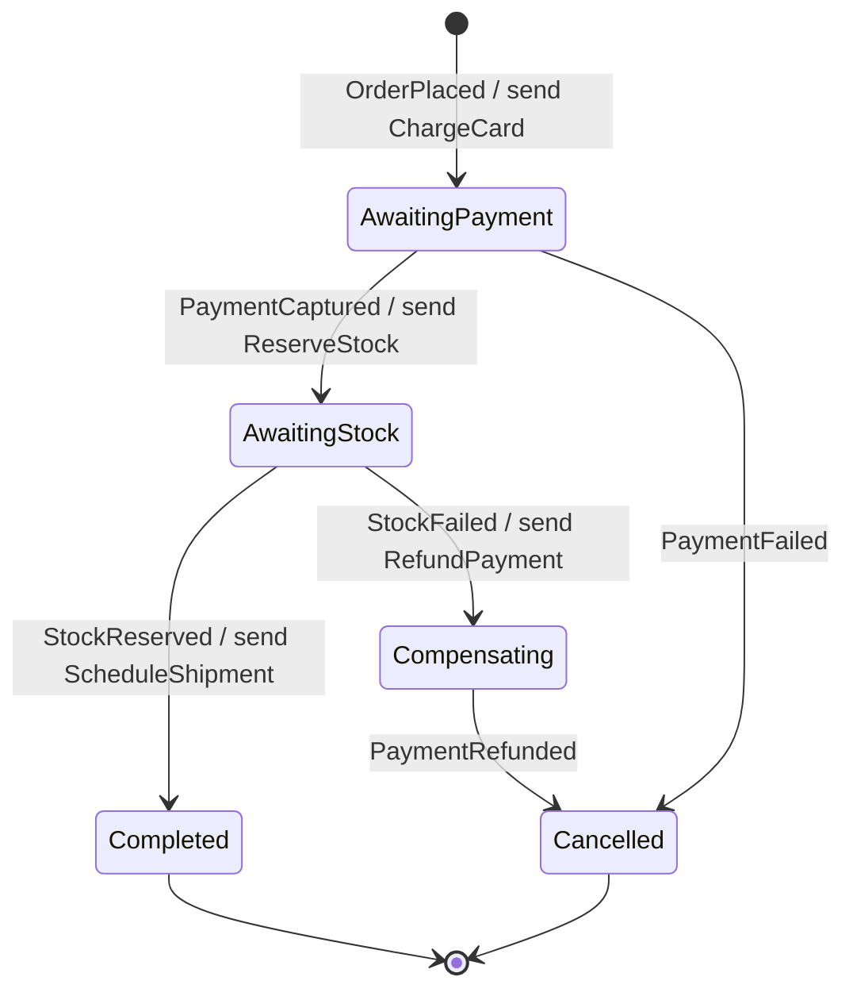

# 08 · Messaging patterns

> The patterns you build with RabbitMQ and when each one fits: work queue, publish/subscribe, routing, topics,
> request/reply (RPC), commands vs events, event notification vs event-carried state, saga (choreography and
> orchestration), claim check, priority, competing consumers vs single active consumer, and anti-patterns.

---

## 1. Work queue (task distribution)



One queue, many competing workers, manual acks, prefetch. Use for CPU/IO-heavy jobs: thumbnails, PDFs, emails,
imports. Sample 02.

## 2. Publish / subscribe



Each subscribing **service** owns a durable queue. The publisher does not know the subscribers. Samples 03, 05.

## 3. Routing / topics

Selective subscriptions with direct (exact key) or topic (patterns) exchanges: alerts by severity, orders by
region, tenants. Samples 04, 05.

## 4. Commands vs events

| | **Command** | **Event** |
|-|-------------|-----------|
| Meaning | "please do X" | "X happened" |
| Naming | imperative: `SendInvoice`, `ResizeImage` | past tense: `OrderPlaced`, `PaymentFailed` |
| Receivers | exactly **one** logical handler | **zero or many** |
| Routing | direct exchange / queue owned by the handler | topic/fanout exchange owned by the publisher |
| Coupling | sender knows who does it | publisher doesn't know subscribers |

MassTransit uses the same split: `Send` for commands (to a queue address), `Publish` for events (sample 14).

## 5. Request / reply (RPC over messaging)



* Reply destination: an exclusive server-named queue per client, or **direct reply-to**
  (`amq.rabbitmq.reply-to`, no queue at all, fastest, the client must consume it in no-ack mode on the same
  channel before publishing).
* **Always time out** and set `Expiration` on requests so stale requests don't pile up.
* Ignore late replies with unknown correlation ids.
* Sample 07 runs 5 concurrent calls through one client, direct reply-to, and a timeout.

> Prefer HTTP/gRPC when you need a synchronous answer. Use broker RPC when you already depend on the broker,
> want load-balanced workers behind a queue, or the caller is itself a background process.

## 6. Event notification vs event-carried state transfer

| Style | Message | Consumer then |
|-------|---------|---------------|
| Notification | `{ "orderId": "..." }` | calls back the Orders API for details (coupling + load) |
| Event-carried state | `{ "orderId", "customerEmail", "total", "lines": [...] }` | has everything it needs, can keep a local copy |

Carry what consumers need, but not your whole database row; events are a public contract.

## 7. Saga: long-running business transactions

There is no distributed transaction across services. A saga is a sequence of local transactions with
**compensating actions** on failure.

### Choreography (events only)



Simple for few steps, hard to see the whole flow when it grows.

### Orchestration (a coordinator sends commands)



The orchestrator stores the saga state (DB) and reacts to replies. MassTransit state machines, NServiceBus and
Wolverine sagas implement this.

## 8. Claim check (large payloads)

```mermaid
flowchart LR
    P[Producer] -->|1 upload 200 MB video| B[(Blob storage)]
    P -->|2 publish VideoUploaded{blobUrl}| X{{media.events}} --> Q[(transcode)] --> C[Transcoder]
    C -->|3 download by URL| B
```

Keep messages small (ideally < 128 KB). RabbitMQ 4 rejects messages above `max_message_size` (16 MiB by default), and big messages hurt memory,
latency and replication.

## 9. Priority lanes

Either a priority queue (`x-max-priority`, sample 10) or **separate queues** (`email.urgent`, `email.bulk`) with
more consumers on the urgent one. Separate queues are easier to monitor and scale independently and work with
quorum queues.

## 10. Competing consumers vs single active consumer vs sharding

| Need | Pattern |
|------|---------|
| Max throughput, order not important | competing consumers |
| Strict order, failover | single active consumer |
| Order per key + parallelism | shard by key: consistent-hash exchange or N queues with `hash(key) % N`, one consumer per queue; or streams/super streams |

## 11. Other useful patterns

* **Scheduled / delayed messages**: TTL + DLX (doc 07).
* **Throttling**: prefetch + limited consumer concurrency to protect a slow partner API.
* **Fan-in / aggregator**: collect several replies with the same correlation id.
* **Wire tap / audit**: bind an extra queue with `#` to see every event (sample 05 `audit`).
* **Competing consumers across regions**: federation / shovel (doc 11).
* **Inbox / outbox**: doc 09.

## 12. Anti-patterns

| Anti-pattern | Why it hurts | Instead |
|--------------|--------------|---------|
| Connection per message | slow, exhausts file descriptors | one long-lived connection |
| Channel per message | slow, churn | one channel per publisher/consumer |
| Queue as a database | huge queues, slow restarts | keep queues short, store state in a DB |
| Polling with `BasicGet` | latency + load | `BasicConsume` |
| `autoAck` for business data | silent loss | manual acks |
| Infinite requeue | hot loops | DLX + delayed retry + delivery limit |
| Sync RPC chains through the broker | all downsides of sync + more moving parts | events or HTTP |
| Huge messages | memory alarms | claim check |
| Sharing one queue between different message types with different consumers | consumers reject each other's messages | one queue per consumer purpose |
| No `MessageId` | impossible to de-duplicate | always set it |

➡️ Next: [09 · Delivery guarantees, idempotency and the outbox](09-delivery-guarantees-outbox.md)
