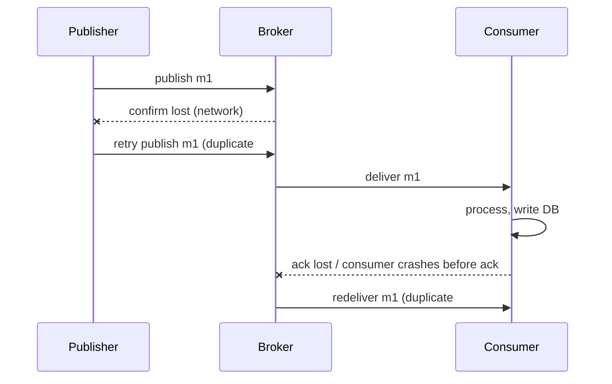
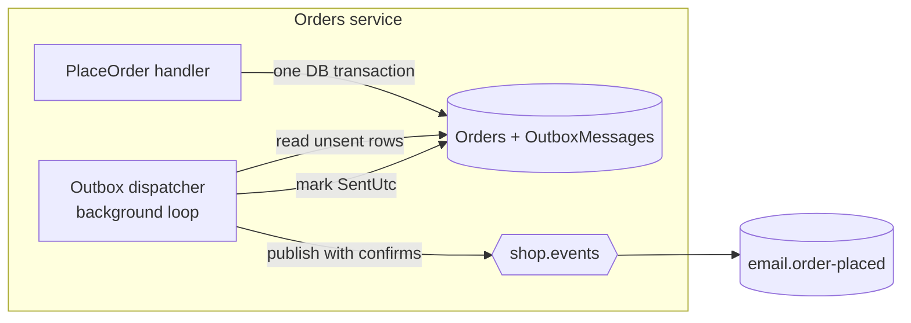
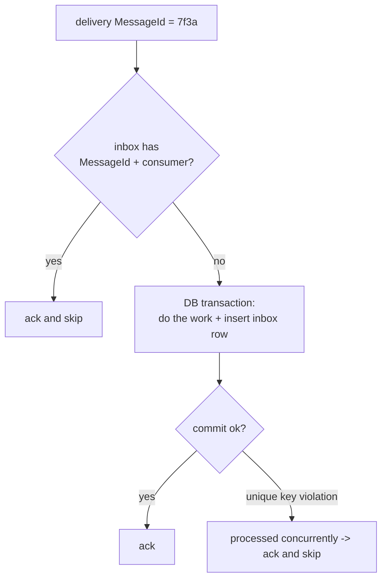
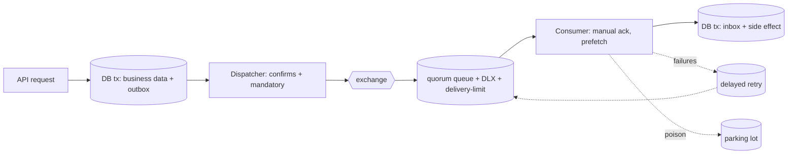

# 09 · Delivery guarantees, idempotency and the transactional outbox

> At-most-once, at-least-once and the "exactly-once" myth; the dual-write problem; the transactional outbox
> (producer side); the inbox / idempotent consumer (consumer side); and ordering.

Sample: [12-OutboxInbox](../samples/12-OutboxInbox).

---

## 1. Delivery guarantees

| Guarantee | How you get it in RabbitMQ | Risk |
|-----------|---------------------------|------|
| **At most once** | no confirms, `autoAck: true` | messages can be lost, never duplicated |
| **At least once** | confirms + persistent + durable/quorum + manual ack after work | **duplicates** are possible |
| **Exactly once** | not possible end-to-end over a network | – |

What you actually build is **at-least-once delivery + idempotent processing = effectively once**.

Where duplicates come from:



## 2. The dual-write problem

```csharp
await db.SaveChangesAsync();                              // 1. order saved
await channel.BasicPublishAsync("shop.events", "order.placed", ...);  // 2. process crashes before this line?
```

| Crash point | Result |
|-------------|--------|
| after 1, before 2 | order exists, **event lost**: no email, no invoice, ever |
| publish first, then DB fails | event says "order placed" but there is **no order** |

You can't put a database and RabbitMQ in one transaction (no 2PC). The outbox solves it.

## 3. Transactional outbox



1. The handler writes the business change **and** an `OutboxMessage` row in **the same transaction**.
2. A dispatcher reads unsent rows in order, publishes each with **publisher confirms**, then marks them sent.
3. If the dispatcher crashes after publishing but before marking → the row is published **again** → duplicate →
   the consumer must be idempotent.

```csharp
db.Orders.Add(order);
db.OutboxMessages.Add(new OutboxMessage
{
    Id = Guid.CreateVersion7(),           // becomes the AMQP MessageId
    Exchange = "shop.outbox-demo",
    RoutingKey = "order.placed",
    Type = nameof(OrderPlaced),
    Payload = JsonSerializer.Serialize(orderPlaced),
    OccurredUtc = now
});
await db.SaveChangesAsync();              // atomic
```

Dispatcher essentials (sample 12 `OutboxDispatcher.cs`): poll every N ms or get woken after commit, `ORDER BY`
occurred time, batch, publish with confirms + `mandatory`, record attempts/errors, clean old sent rows. With
several instances lock rows (`SELECT ... FOR UPDATE SKIP LOCKED` in PostgreSQL) or run one dispatcher.

Alternatives: **CDC** (Debezium reads the DB log and publishes), or a framework outbox (MassTransit EF Core outbox,
Wolverine, NServiceBus, CAP).

## 4. Inbox / idempotent consumer



```csharp
if (await db.InboxMessages.AnyAsync(m => m.MessageId == messageId && m.Consumer == Name))
{
    await channel.BasicAckAsync(delivery.DeliveryTag, false);       // duplicate
    return;
}
db.SentEmails.Add(...);                                             // the side effect, recorded
db.InboxMessages.Add(new InboxMessage { MessageId = messageId, Consumer = Name, ProcessedUtc = DateTime.UtcNow });
await db.SaveChangesAsync();                                        // one transaction, PK (MessageId, Consumer)
await channel.BasicAckAsync(delivery.DeliveryTag, false);
```

Sample 12 output:

```text
step 2: dispatcher crashes after publishing but before saving SentUtc
step 3: dispatcher restarts and publishes the 'unsent' rows again -> duplicates on the wire
email-service  email to mona@example.com ...
email-service  email to omar@example.com ...
email-service  email to sara@example.com ...
email-service  duplicate ... already in inbox -> ack and skip
email-service  duplicate ... already in inbox -> ack and skip
orders=3, emails sent=3, unsent outbox rows=0
deliveries=5: processed=3, duplicates skipped=2
```

Other ways to be idempotent:

* **Natural idempotency**: `SET status = 'Paid'` is safe to repeat; `balance = balance - 100` is not.
* **Unique constraints** on business keys (one invoice per order id; sample 12 also has a unique index on
  `SentEmail.OrderId`).
* **Version / sequence checks**: ignore events older than the stored version.
* External side effects (emails, payment gateways): pass an **idempotency key** to the provider.
* Inbox rows can be deleted after a retention window longer than any possible redelivery.

## 5. Ordering

* Per queue, per publisher channel, single consumer: ordered.
* Retries, competing consumers, prefetch > 1 and requeue reorder messages.
* Design for disorder: include `OccurredUtc` / a version in events and ignore stale ones; or use single active
  consumer / sharding / streams when order really matters (doc 08 §10).

## 6. Putting it all together



That is the production-grade "reliable messaging" recipe this repository builds up to.

➡️ Next: [10 · .NET packages and libraries](10-dotnet-packages.md)
