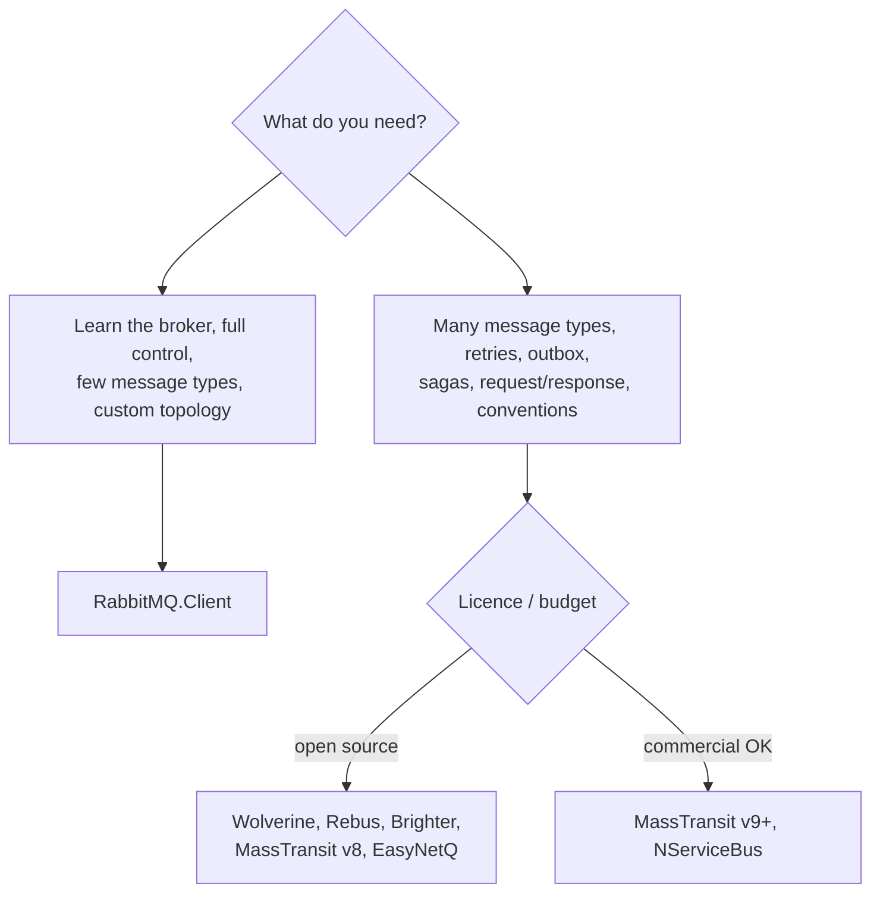

# 10 · .NET packages and libraries

> Which NuGet packages you need, what each one is for, the RabbitMQ.Client 6 → 7 changes, and when to use the
> raw client vs a framework (MassTransit, EasyNetQ, Wolverine, NServiceBus, Rebus, Brighter).

Versions used in this repo are pinned in [Directory.Packages.props](../Directory.Packages.props).

---

## 1. The package map

| Package | Role | Used in |
|---------|------|---------|
| **RabbitMQ.Client** (7.x) | official AMQP 0-9-1 client, async API | all samples, tests |
| RabbitMQ.Client.OpenTelemetry | `ActivitySource` tracing for publish/consume, trace context in headers | production apps |
| RabbitMQ.Stream.Client | native stream protocol (port 5552): high throughput, dedup, super streams | big stream workloads |
| RabbitMQ.AMQP.Client | AMQP 1.0 client for RabbitMQ 4 | new AMQP 1.0 apps |
| **MassTransit.RabbitMQ** | messaging framework: consumers, retries, outbox, sagas, request/response | sample 14 |
| EasyNetQ | simple opinionated API on top of RabbitMQ.Client | small services |
| WolverineFx.RabbitMQ | mediator + messaging, outbox, Marten/EF integration | |
| NServiceBus.RabbitMQ | commercial service bus with sagas, tooling, support | enterprise |
| Rebus.RabbitMq, Paramore.Brighter.MessagingGateway.RMQ | other lightweight buses | |
| Aspire.Hosting.RabbitMQ | .NET Aspire AppHost: run RabbitMQ as a resource | Aspire solutions |
| Aspire.RabbitMQ.Client | registers `IConnection` in DI + health checks + tracing from Aspire config | Aspire services |
| AspNetCore.HealthChecks.Rabbitmq | `/health` check for the broker | ASP.NET Core |
| **Testcontainers.RabbitMq** | real broker in Docker for integration tests | tests |
| Polly / Microsoft.Extensions.Resilience | in-process retries, circuit breakers | consumers/publishers |
| **Microsoft.EntityFrameworkCore.*** | outbox/inbox tables | sample 12 |

Minimum to start:

```bash
dotnet add package RabbitMQ.Client
```

## 2. RabbitMQ.Client 7 essentials

```csharp
var factory = new ConnectionFactory { Uri = new Uri(uri), ClientProvidedName = "orders-api" };
await using IConnection connection = await factory.CreateConnectionAsync();
await using IChannel channel = await connection.CreateChannelAsync(
    new CreateChannelOptions(publisherConfirmationsEnabled: true, publisherConfirmationTrackingEnabled: true));

await channel.QueueDeclareAsync("q", durable: true, exclusive: false, autoDelete: false);
await channel.BasicPublishAsync("", "q", mandatory: true, basicProperties: new BasicProperties { Persistent = true }, body: body);

var consumer = new AsyncEventingBasicConsumer(channel);
consumer.ReceivedAsync += async (_, ea) => { await channel.BasicAckAsync(ea.DeliveryTag, false); };
await channel.BasicConsumeAsync("q", autoAck: false, consumer: consumer);
```

### Migrating from 6.x (old tutorials)

| 6.x | 7.x |
|-----|-----|
| `IModel` | `IChannel` |
| `factory.CreateConnection()` | `await factory.CreateConnectionAsync()` |
| `connection.CreateModel()` | `await connection.CreateChannelAsync(options)` |
| `channel.QueueDeclare(...)` | `await channel.QueueDeclareAsync(...)` (everything is async) |
| `channel.CreateBasicProperties()` | `new BasicProperties { ... }` |
| `EventingBasicConsumer` + `Received` | `AsyncEventingBasicConsumer` + `ReceivedAsync` |
| `DispatchConsumersAsync = true` | always async |
| `ConfirmSelect()` + `WaitForConfirmsOrDie()` | `CreateChannelOptions(publisherConfirmationsEnabled, publisherConfirmationTrackingEnabled)`; `BasicPublishAsync` awaits the confirm |
| `BasicReturn` event | `BasicReturnAsync` event, or `PublishReturnException` with tracking |
| header tables `IDictionary<string, object>` | `IDictionary<string, object?>` |

## 3. Raw client vs a framework



| | RabbitMQ.Client | Framework (MassTransit etc.) |
|-|----------------|-------------------------------|
| Learning value | you see every AMQP concept | concepts hidden behind conventions |
| Boilerplate | connections, serialization, retries, error queues by hand | done for you |
| Topology | you design it | generated (exchange per message type, `_error` / `_skipped` queues) |
| Transport portability | RabbitMQ only | swap to Azure Service Bus, SQS, Kafka riders, in-memory for tests |
| Advanced features | build yourself (outbox, sagas) | built in |

### MassTransit (sample 14)

```csharp
builder.Services.AddMassTransit(bus =>
{
    bus.AddConsumer<OrderSubmittedConsumer>();
    bus.AddRequestClient<CheckStock>();
    bus.UsingRabbitMq((context, rabbit) =>
    {
        rabbit.Host("localhost", "/", h => { h.Username("guest"); h.Password("guest"); });
        rabbit.UseMessageRetry(r => r.Intervals(100, 200, 400));
        rabbit.ConfigureEndpoints(context);
    });
});
```

What it creates on RabbitMQ: a fanout exchange per message type (`Shop.Contracts:OrderSubmitted`), an exchange +
queue per consumer endpoint (`order-submitted`), `order-submitted_error` for faulted messages and
`order-submitted_skipped` for messages nobody handles, and it publishes `Fault<T>` events.

> **Licensing**: MassTransit **v8 is Apache 2.0** (this repo pins 8.5.x). From **v9** MassTransit is a commercial
> product that needs a licence for production use. Check the current terms before choosing it.

## 4. Hosting patterns in ASP.NET Core

* Register **one `IConnection` as a singleton** (sample 13 creates it at startup; Aspire's
  `builder.AddRabbitMQClient("messaging")` does the same plus health checks and tracing).
* Publishers: a singleton service that owns a channel (or a small pool), guarded for concurrent requests.
* Consumers: `BackgroundService` per queue, own channel, graceful `StopAsync`.
* Health: `connection.IsOpen` or AspNetCore.HealthChecks.Rabbitmq.
* Configuration: connection string / URI from configuration or user secrets, never hard-coded passwords.

## 5. Serialization

`System.Text.Json` with `JsonSerializerDefaults.Web` (sample `Json.cs`), `ContentType = "application/json"`,
`Type = nameof(Event)`. For high volume consider Protobuf/MessagePack. Version contracts additively (new optional
fields), never rename or remove fields that consumers use.

## 6. Observability packages

* `RabbitMQ.Client.OpenTelemetry` + `OpenTelemetry.Extensions.Hosting` → traces that cross the broker: the trace
  context travels in message headers, so the consumer span links to the publisher span.
* Broker metrics: the `rabbitmq_prometheus` plugin (port 15692) + Grafana dashboards.

➡️ Next: [11 · Production and operations](11-production-operations.md)
