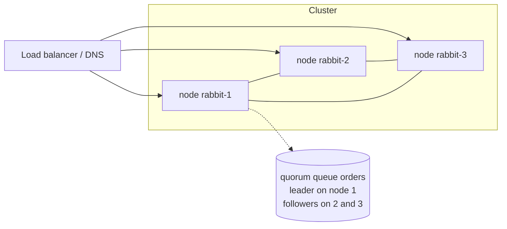

# 11 · Production and operations

> Running RabbitMQ for real: connection management, clustering and quorum queues, federation and shovel,
> security (users, vhosts, permissions, TLS), configuration, monitoring and alerting, resource alarms, capacity
> planning, upgrades, and a go-live checklist.

---

## 1. Client-side rules

| Rule | Why |
|------|-----|
| One long-lived connection per process (maybe 2: publish / consume) | connections are expensive TCP + TLS + auth handshakes |
| One channel per thread/consumer, reuse it | channels are not designed for heavy concurrent use; creating them per message is slow |
| Set `ClientProvidedName` | find the app in the UI and logs |
| Heartbeats (default 60 s; 30 s is common) | detect dead TCP connections behind load balancers/NAT |
| Automatic recovery on, log recovery events | survive network blips and node restarts |
| Publish with confirms and a timeout | no silent loss, no hung requests |
| Consumers: manual ack, prefetch, idempotent, DLX | doc 04, 07, 09 |
| Connect to several nodes or a load balancer | `factory.CreateConnectionAsync(new[] { "rmq-1", "rmq-2", "rmq-3" })` |

## 2. Clustering



* Use an **odd number of nodes (3 or 5)**. Quorum queues and streams replicate across them; classic queues live
  on one node.
* Users, vhosts, exchanges, bindings, policies are cluster-wide metadata (stored in Khepri in RabbitMQ 4).
* A cluster is for one data centre/region with low latency between nodes. Across regions use **federation** or
  **shovel**.
* On Kubernetes use the **RabbitMQ Cluster Operator**; managed options include Amazon MQ for RabbitMQ and
  CloudAMQP.

## 3. Federation and shovel

| | Federation | Shovel |
|-|-----------|--------|
| What | an exchange/queue on a downstream broker pulls from upstream brokers | a client inside the broker that moves messages from a source to a destination |
| Use | multi-region pub/sub, loose coupling between clusters | migrations, moving parking-lot messages back, bridging to another vhost/broker |
| Topology | declarative via policies | static (config) or dynamic (parameters) |

## 4. Security

* **Delete or disable `guest`** (it only works from localhost on non-Docker installs by default).
* One **user per application** with least-privilege permissions per vhost:

```bash
rabbitmqctl add_vhost shop
rabbitmqctl add_user orders-api 'S3cret!'
rabbitmqctl set_permissions -p shop orders-api '^$' '^shop\.events$' '^$'      # configure, write, read
rabbitmqctl add_user email-service 'S3cret!'
rabbitmqctl set_permissions -p shop email-service '^email\..*' '^$' '^email\..*'
```

* **TLS** on 5671 (and the management UI over HTTPS), optional mutual TLS / x509 auth.
* Use **vhosts** to separate environments or tenants.
* Secrets from Key Vault / environment, not source code. Rotate passwords.
* Consider OAuth 2 (`rabbitmq_auth_backend_oauth2`) for central identity.
* Restrict management UI access; use tags (`monitoring`, `management`, `administrator`).

## 5. Configuration that matters (`rabbitmq.conf`)

```ini
vm_memory_high_watermark.relative = 0.6
disk_free_limit.absolute = 5GB
consumer_timeout = 1800000            # 30 min, unacked messages beyond this close the channel
max_message_size = 16777216           # 16 MiB (4.x default)
heartbeat = 60
default_user = admin                  # first boot only
default_pass = change-me
```

Define topology/users/policies as code with a **definitions file** (`load_definitions = /etc/rabbitmq/definitions.json`)
exported from the UI, or with Terraform / the Kubernetes Messaging Topology Operator.

## 6. Monitoring and alerting

Enable `rabbitmq_prometheus` (port 15692) and use the official Grafana dashboards.

| Metric | Alert when |
|--------|-----------|
| Queue depth (ready) | growing for minutes → consumers too slow / down |
| Unacked messages | high and flat → stuck consumers / forgotten acks |
| Consumers per queue | 0 on a business queue |
| Publish vs deliver/ack rate | publish ≫ ack for a long time |
| Parking lot / DLQ depth | > 0 |
| Memory / disk alarms | any alarm |
| File descriptors / connections / channels | near limits, or channel churn (opened/closed per second) |
| Quorum queue members | members missing / no leader |
| Redeliveries | spikes (poison messages, crashing consumers) |

Health checks: `rabbitmq-diagnostics -q ping` (liveness), `check_running`, `check_local_alarms`,
`check_port_connectivity`. Apps: trace with OpenTelemetry (doc 10), log `MessageId`/`CorrelationId`.

## 7. Resource alarms and flow control

When memory or disk crosses a threshold, **all publishing connections are blocked** cluster-wide until it
recovers; consumers keep working. Prevent it: keep queues short, use max-length policies, size disks, alert on
queue growth, separate publisher and consumer connections.

## 8. Capacity planning tips

* Throughput depends on message size, persistence, confirms, replication, prefetch and number of queues. Measure
  with **PerfTest** (`rabbitmq-perf-test`) using your message sizes.
* A single queue is single-threaded on the broker (one Erlang process / one Raft leader): very hot queues
  should be sharded into several queues.
* Quorum queues need fast disks (fsync). Give each node enough RAM and disk headroom.

## 9. Upgrades and changes

* Read the release notes: RabbitMQ 4.0 removed classic mirrored queues and changed defaults (Khepri metadata
  store, `max_message_size`, quorum delivery-limit 20).
* Rolling upgrades across patch/minor versions with feature flags enabled step by step; blue-green (new cluster +
  shovel/federation) for big jumps.
* Changing queue arguments requires a new queue: create `orders.v2`, bind it, move consumers, drain the old one
  (or prefer policies, doc 06).

## 10. Go-live checklist

- [ ] 3-node cluster (or managed service), quorum queues for business data
- [ ] guest disabled, one user per app, least-privilege permissions, TLS
- [ ] DLX + delivery limit + max-length policies on business queues
- [ ] publisher confirms + mandatory, consumers with manual acks and prefetch
- [ ] outbox / inbox where messages must match DB state
- [ ] Prometheus + Grafana + alerts on depth, unacked, consumers, alarms, DLQ
- [ ] definitions/topology in source control
- [ ] runbook: replay parking lot, purge, scale consumers, node failure
- [ ] load test with realistic message sizes

➡️ Next: [12 · RabbitMQ vs Kafka and others](12-rabbitmq-vs-others.md)
