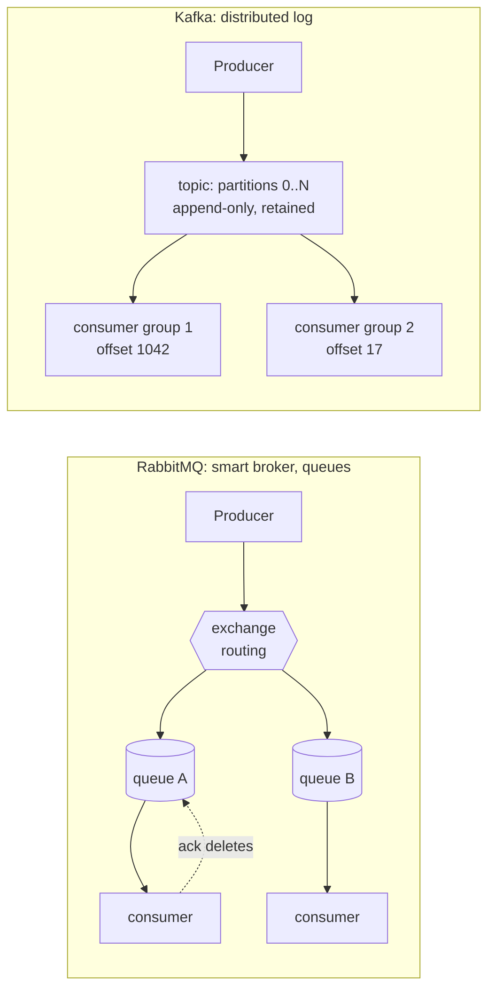
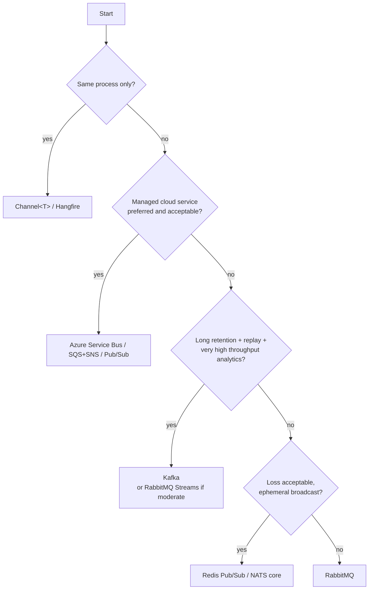

# 12 · RabbitMQ vs Kafka and other options

> How RabbitMQ compares to Kafka, Azure Service Bus, Amazon SQS/SNS, Redis, NATS, MQTT brokers and in-process
> queues, with a decision guide.

---

## 1. RabbitMQ vs Kafka: different models

| | RabbitMQ (queues) | Kafka |
|-|-------------------|-------|
| Model | message broker: exchanges route to queues, ack deletes | distributed commit log: append, consumers track offsets |
| Retention | until consumed (streams: by time/size) | by time/size, typically days or forever |
| Replay | no (streams: yes) | yes, any offset |
| Routing | rich: direct, topic, headers, fanout, DLX | by topic + partition key only |
| Ordering | per queue | per partition |
| Per-message features | ack/nack, TTL, priority, delayed retry, delivery limit | none (offset commits only) |
| Throughput | tens of thousands msg/s per queue, more with streams | millions msg/s, built for it |
| Latency | very low at moderate load | low, optimized for throughput |
| Consumer scaling | competing consumers on a queue, any number | max parallelism = partitions in a group |
| Protocols | AMQP 0-9-1, AMQP 1.0, MQTT, STOMP, streams | Kafka protocol |
| Typical use | task queues, commands, service integration, RPC, complex routing, retries | event streaming, analytics pipelines, event sourcing, CDC, log aggregation |
| Operations | easier for small/medium setups | heavier (KRaft/ZooKeeper era), partitions planning |

**Rules of thumb**

* Work to be done once by someone (send email, resize image, process payment) → **RabbitMQ**.
* Facts many systems read, replay and aggregate for analytics → **Kafka** (or RabbitMQ streams for moderate scale).
* Many teams use both: RabbitMQ for operational messaging, Kafka for the data platform.

## 2. Other options

| Option | What it is | Choose it when | Compared to RabbitMQ |
|--------|-----------|----------------|----------------------|
| **Azure Service Bus** | managed broker (queues, topics/subscriptions, sessions, scheduled messages, DLQ) | you're on Azure and don't want to operate a broker | similar concepts, managed, sessions for ordering, built-in delayed delivery, AMQP 1.0, cost per operation |
| **Amazon SQS + SNS** | managed queue + pub/sub fan-out | you're on AWS, simple queues at any scale | simpler, polling-based, FIFO queues optional, no complex routing |
| **Google Pub/Sub** | managed pub/sub | GCP | push/pull subscriptions, replay by seek |
| **Redis Pub/Sub** | fire-and-forget broadcast | live notifications where loss is acceptable | no persistence, no acks |
| **Redis Streams** | log with consumer groups | you already run Redis, small/medium volume | fewer guarantees, memory-bound |
| **NATS / JetStream** | very fast lightweight messaging (+ persistence with JetStream) | edge/IoT, low latency, cloud native | simpler, less routing, very high performance |
| **MQTT brokers** (Mosquitto, EMQX, HiveMQ) | IoT publish/subscribe | constrained devices | RabbitMQ also speaks MQTT via a plugin |
| **ActiveMQ / Artemis** | JMS brokers | Java/JMS ecosystems | similar category |
| **In-process `Channel<T>`** | queue inside one process | producer and consumer in the same app, loss on restart acceptable | no network, no durability, no cross-service |
| **Hangfire / Quartz** | background jobs persisted in a DB | scheduled/recurring jobs inside your app | job scheduler, not an integration bus |
| **Database outbox/jobs table** | rows as messages | low volume in one service; outbox feeding a broker | doc 01, 09 |

## 3. Decision guide

## 4. Same scenario, different tools

"When an order is placed, send an email, update stock and feed analytics":

| Tool | Design |
|------|--------|
| RabbitMQ | topic exchange `shop.events`, queues `email.order-placed`, `inventory.order-placed`, `analytics.orders` |
| Kafka | topic `orders` (partitioned by order id), consumer groups `email`, `inventory`, `analytics` |
| Azure Service Bus | topic `orders` with subscriptions `email`, `inventory`, `analytics` (+ SQL filters) |
| AWS | SNS topic `orders` fanning out to SQS queues `email`, `inventory`, `analytics` |

The concepts transfer: **a publisher, an event, independent subscriber queues, at-least-once, idempotent
consumers**. Learn them once with RabbitMQ and they apply everywhere.

➡️ Next: [13 · Interview questions and exercises](13-interview-questions-and-exercises.md)
