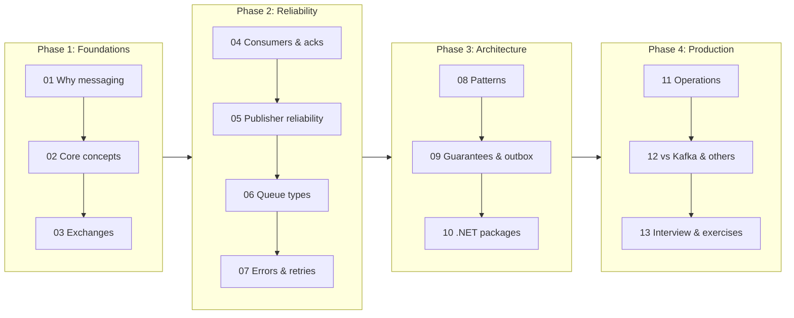

# Learning path

Read the docs in order and run the matching sample after each one. Every doc has workflow diagrams (Mermaid,
rendered by GitHub), C# snippets and links to samples and tests.

| # | Doc | Samples | Level |
|---|-----|---------|-------|
| 01 | [Why messaging: traditional integration vs a broker, when to use / not use](01-why-messaging.md) | – | beginner |
| 02 | [Core concepts and the AMQP model](02-core-concepts.md) | 01 | beginner |
| 03 | [Exchanges and routing](03-exchanges-and-routing.md) | 01, 03, 04, 05, 06 | beginner |
| 04 | [Consumers, acknowledgements and prefetch](04-consumers-acks-prefetch.md) | 02, 10 | intermediate |
| 05 | [Publisher reliability: durability, confirms, returns](05-publisher-reliability.md) | 08 | intermediate |
| 06 | [Queue types and arguments: classic, quorum, stream](06-queue-types-and-arguments.md) | 10, 11 | intermediate |
| 07 | [Errors, dead-lettering and retries](07-errors-dead-letter-retry.md) | 09 | intermediate |
| 08 | [Messaging patterns: RPC, sagas, claim check, ...](08-messaging-patterns.md) | 02–07, 14 | advanced |
| 09 | [Delivery guarantees, idempotency and the outbox](09-delivery-guarantees-outbox.md) | 12 | advanced |
| 10 | [.NET packages and libraries](10-dotnet-packages.md) | 13, 14 | advanced |
| 11 | [Production and operations](11-production-operations.md) | – | advanced |
| 12 | [RabbitMQ vs Kafka and other options](12-rabbitmq-vs-others.md) | – | all |
| 13 | [Interview questions and exercises](13-interview-questions-and-exercises.md) | all | all |

## How to study a topic

1. Read the doc and its diagrams.
2. Run the sample and compare the console output with the diagram.
3. Open http://localhost:15672 while it runs: exchanges, queues, bindings, message rates.
4. Read the related learning test and run it: `dotnet test --filter-class LearningTests.RoutingTests`.
5. Do the exercises in doc 13.
