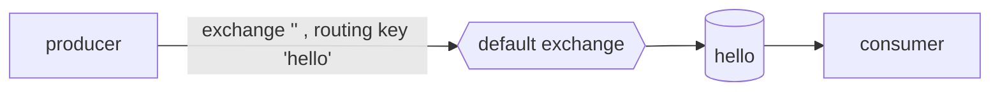

# 01 · Hello World

The smallest complete flow: connect, declare a queue, publish through the default exchange, consume.



## Run

```bash
dotnet run --project samples/01-HelloWorld                  # demo: consumer + producer in one process
dotnet run --project samples/01-HelloWorld -- receive       # terminal 1
dotnet run --project samples/01-HelloWorld -- send Hi there # terminal 2
```

## What to notice

* `ConnectionFactory` → `IConnection` (TCP) → `IChannel` (all work happens on channels).
* `QueueDeclareAsync` is idempotent: both sides declare the queue, whoever starts first creates it.
* Separate channels for producing and consuming.
* `autoAck: true` here for simplicity: the message is deleted as soon as it is delivered. Sample 02 shows why
  business code uses manual acks.
* Stop the receiver, send a few messages, look at **Queues → hello** in http://localhost:15672, start the receiver.

Theory: [02 Core concepts](../../docs/02-core-concepts.md).
