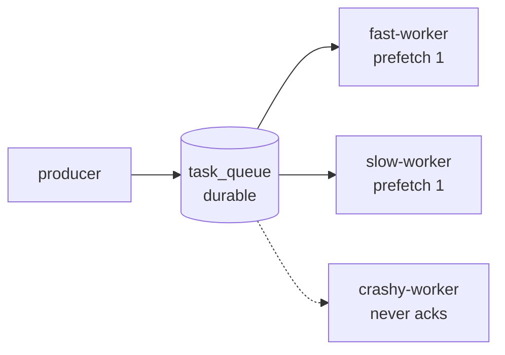

# 02 · Work queues (competing consumers)

Distribute time-consuming tasks between workers, never lose a task when a worker dies, and give more work to
faster workers.



## Run

```bash
dotnet run --project samples/02-WorkQueues                 # demo
dotnet run --project samples/02-WorkQueues -- worker A     # terminal 1
dotnet run --project samples/02-WorkQueues -- worker B     # terminal 2
dotnet run --project samples/02-WorkQueues -- send 20      # terminal 3
```

## What the demo shows

1. `crashy-worker` takes task 1 and "crashes" without acking.
2. A fast and a slow worker join; tasks 2–12 are published.
3. The crashy channel closes → task 1 goes back to the queue and is processed with `(REDELIVERED)`.
4. Result: fast-worker ≈ 10 tasks, slow-worker ≈ 2 → **prefetch = 1 gives fair dispatch**.

## What to notice

* `autoAck: false` + `BasicAckAsync` **after** the work = at-least-once.
* `BasicQosAsync(0, 1, false)`: at most one unacked message per worker. Remove it and compare.
* `Persistent = true` messages in a durable queue survive a broker restart.

Theory: [04 Consumers, acks, prefetch](../../docs/04-consumers-acks-prefetch.md).
