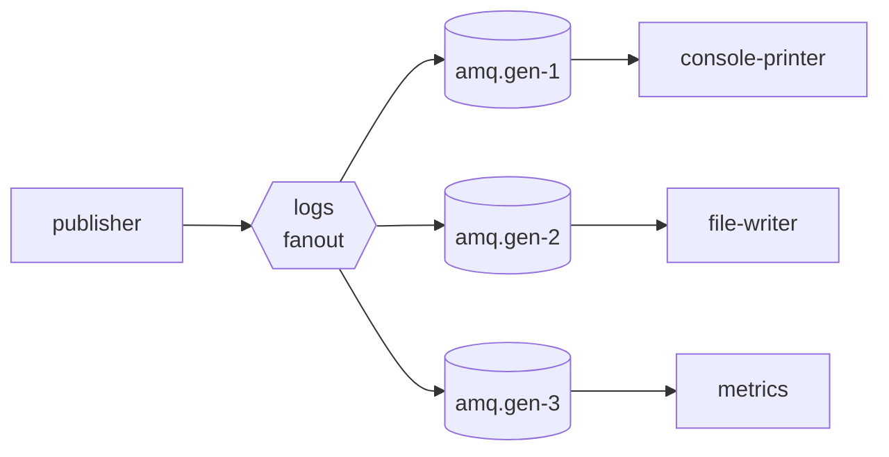

# 03 · Publish / Subscribe (fanout)

Broadcast every message to every subscriber.



## Run

```bash
dotnet run --project samples/03-PublishSubscribe
dotnet run --project samples/03-PublishSubscribe -- subscribe screen
dotnet run --project samples/03-PublishSubscribe -- publish "error: disk full"
```

## What to notice

* Step 1 publishes before anyone is bound: the message is **dropped** (an exchange is not storage).
* Each subscriber declares `queue: ""`, `exclusive: true`, `autoDelete: true` → server-named temporary queue that
  disappears with the subscriber. Fine for live views; services that must not miss events use durable named
  queues (sample 05).
* 3 subscribers × 3 messages = 9 deliveries.

Theory: [03 Exchanges and routing](../../docs/03-exchanges-and-routing.md).
