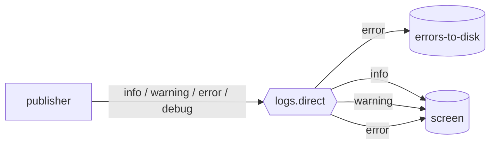

# 04 · Routing (direct exchange)

Subscribe selectively with exact routing keys.



## Run

```bash
dotnet run --project samples/04-Routing
dotnet run --project samples/04-Routing -- subscribe warning error
dotnet run --project samples/04-Routing -- publish error "payment failed"
```

## What to notice

* One queue can have several bindings; one key can be bound by several queues.
* `error` reaches both queues, `debug` matches nothing and is dropped.

Theory: [03 Exchanges and routing](../../docs/03-exchanges-and-routing.md).
