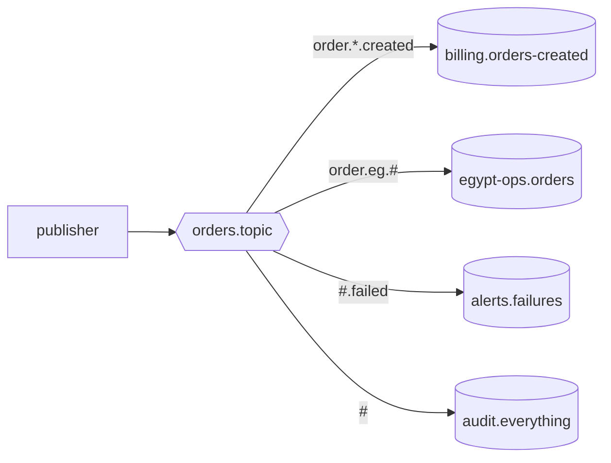

# 05 · Topics (topic exchange)

Route domain events by pattern: `order.<country>.<event>`.



| Routing key | billing | egypt-ops | failures | audit |
|-------------|:-:|:-:|:-:|:-:|
| order.eg.created | ✅ | ✅ | | ✅ |
| order.sa.created | ✅ | | | ✅ |
| order.eg.cancelled | | ✅ | | ✅ |
| order.eg.payment.failed | | ✅ | ✅ | ✅ |
| inventory.low-stock | | | | ✅ |

## Run

```bash
dotnet run --project samples/05-Topics
```

## What to notice

* `*` = exactly one word, `#` = zero or more words.
* Each service owns a **durable named** queue with manual acks: it won't miss events while restarting.
* `TopicMatcher` in `Program.cs` reimplements the matching rules to compute the expected 11 deliveries.

Theory: [03 Exchanges and routing](../../docs/03-exchanges-and-routing.md).
