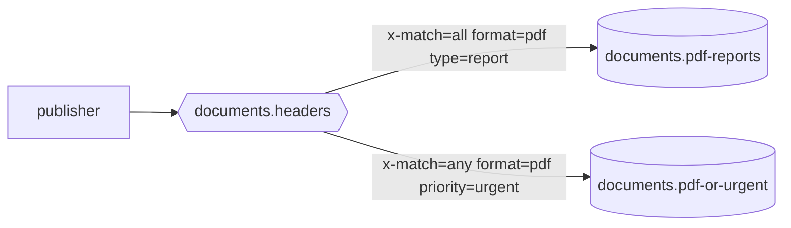

# 06 · Headers exchange

Route on message headers instead of the routing key.



| Document | headers | pdf-reports (all) | pdf-or-urgent (any) |
|----------|---------|:-:|:-:|
| Q3 sales report | format=pdf, type=report | ✅ | ✅ |
| Invoice 7781 | format=pdf, type=invoice | | ✅ |
| Contract draft | format=docx, priority=urgent | | ✅ |
| Team notes | format=docx, type=report | | |

## Run

```bash
dotnet run --project samples/06-Headers
```

## What to notice

* The routing key is ignored.
* String header values arrive as `byte[]`; `MessageHeaders.Describe` decodes them.
* Prefer topic keys when criteria are hierarchical; headers exchanges are slower and less common.

Theory: [03 Exchanges and routing](../../docs/03-exchanges-and-routing.md).
