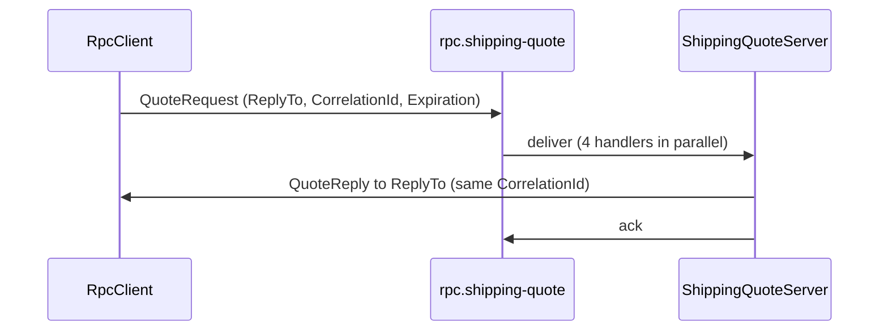

# 07 · RPC / request-reply

A shipping-quote service answers requests over RabbitMQ.



## Run

```bash
dotnet run --project samples/07-Rpc
```

## What the demo shows

* **Client A**: exclusive server-named reply queue, 5 concurrent calls matched by correlation id.
* **Client B**: direct reply-to (`amq.rabbitmq.reply-to`), no reply queue at all.
* **Client C**: calls a queue with no server → `TimeoutException` after 2 s.

## What to notice

* `RpcClient` keeps a `ConcurrentDictionary<correlationId, TaskCompletionSource>`.
* `Expiration` on the request = the timeout, so stale requests expire in the queue.
* The server channel uses `consumerDispatchConcurrency: 4` → requests are handled in parallel.
* Prefer events or HTTP for most cases; see [08 Patterns](../../docs/08-messaging-patterns.md).
