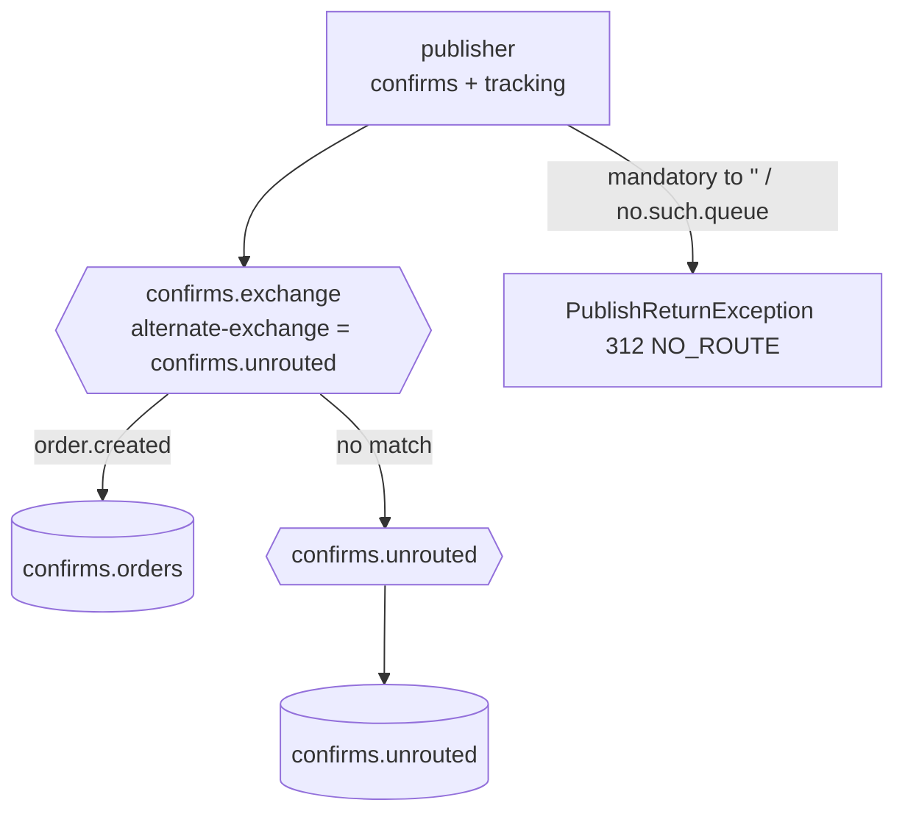

# 08 · Publisher confirms, mandatory, returns, alternate exchange

Know for sure that the broker stored every message, and what happens to messages that can't be routed.



## Run

```bash
dotnet run --project samples/08-PublisherConfirms
```

## Typical output

```text
one-by-one  2000 confirmed in ~1600 ms
batched     2000 confirmed in ~60 ms
broker-return  returned: 312 NO_ROUTE, exchange '', key 'no.such.queue'
publisher      PublishException: IsReturn=True
alternate-exch found 'rescued by AE' in 'confirms.unrouted'
publisher      AlreadyClosedException: 404 NOT_FOUND - no exchange 'exchange.that.does.not.exist'
```

## What to notice

* `CreateChannelOptions(publisherConfirmationsEnabled: true, publisherConfirmationTrackingEnabled: true)` →
  `BasicPublishAsync` completes when the broker confirms.
* Batching outstanding publishes is ~25× faster than awaiting each one.
* Publishing to a missing exchange is a **channel-level error**: the channel is closed, open a new one.

Theory: [05 Publisher reliability](../../docs/05-publisher-reliability.md).
