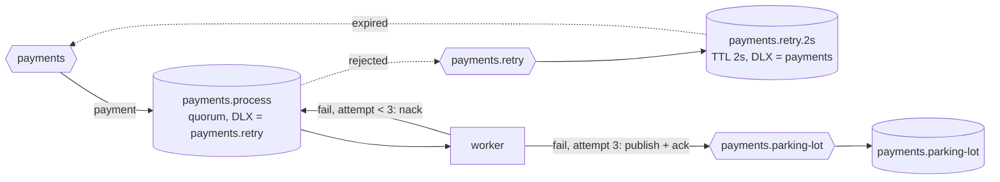

# 09 · Dead letter exchange + delayed retry + parking lot

Retry transient failures after a delay, give up on poison messages, keep them for inspection.



## Run

```bash
dotnet run --project samples/09-DeadLetterRetry
```

## What the demo shows

| Payment | Behaviour | Outcome |
|---------|-----------|---------|
| pay-1 | healthy | succeeds on attempt 1 |
| pay-2 | gateway times out twice | succeeds on attempt 3 (after 2 × 2 s) |
| pay-3 | card rejected every time | parked after attempt 3 with `x-error`, `x-attempts` headers |

## What to notice

* The attempt number comes from the broker's `x-death` header (`MessageHeaders.DeathCount`).
* The retry queue has no consumers: the TTL is the timer.
* All queues are quorum queues (replicated, durable).

Theory: [07 Errors, dead-lettering and retries](../../docs/07-errors-dead-letter-retry.md).
