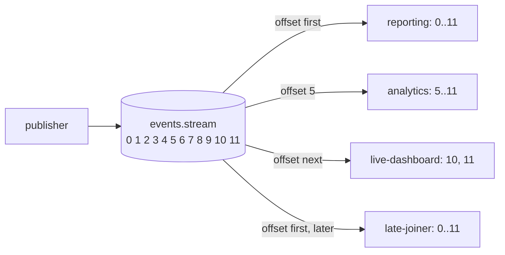

# 11 · Streams

An append-only, replayable log inside RabbitMQ, consumed over plain AMQP.



## Run

```bash
dotnet run --project samples/11-Streams
```

## What to notice

* Declared with `x-queue-type = stream` and retention `x-max-age = 7D`.
* Consumers **must** set prefetch and use manual acks; acks give credit, they don't delete.
* `x-stream-offset` accepts `first`, `last`, `next`, a numeric offset, a timestamp or an interval like `"10m"`.
* Every delivery carries its position in the `x-stream-offset` header.
* For very high throughput use the native stream protocol (`RabbitMQ.Stream.Client`).

Theory: [06 Queue types](../../docs/06-queue-types-and-arguments.md),
[12 RabbitMQ vs Kafka](../../docs/12-rabbitmq-vs-others.md).
