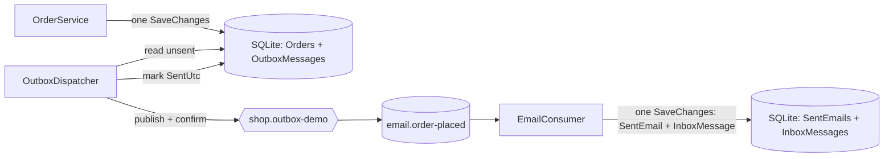

# 12 · Transactional outbox + inbox (idempotent consumer)

Never lose an event that belongs to a database change, and never apply a duplicate twice.



## Run

```bash
dotnet run --project samples/12-OutboxInbox
```

## What the demo shows

1. Order 1 is saved with its outbox row and dispatched normally.
2. Orders 2 and 3 are dispatched, but the dispatcher "crashes" after publishing and before saving `SentUtc`.
3. The dispatcher restarts and publishes them **again** → 5 deliveries for 3 events.
4. The consumer's inbox (primary key `MessageId + Consumer`) skips the 2 duplicates:
   `orders=3, emails sent=3, deliveries=5: processed=3, duplicates skipped=2`.

## Files

* `Data.cs`: entities and `ShopDbContext`.
* `OrderService.cs`: business write + outbox row in one transaction.
* `OutboxDispatcher.cs`: publishes pending rows with confirms and `mandatory`.
* `EmailConsumer.cs`: inbox check, side effect + inbox row in one transaction, then ack.

Theory: [09 Delivery guarantees and the outbox](../../docs/09-delivery-guarantees-outbox.md).
