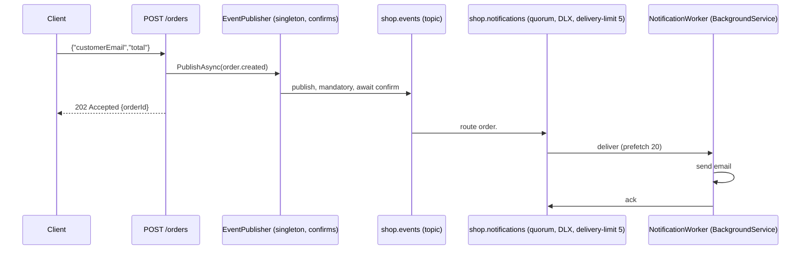

# 13 · Orders API (ASP.NET Core + BackgroundService)

How RabbitMQ fits in a real web service: an HTTP endpoint publishes an event and returns `202 Accepted`; a hosted
background worker consumes it.



## Run

```bash
dotnet run --project samples/13-OrdersApi
curl -X POST http://localhost:5080/orders -H "Content-Type: application/json" -d "{\"customerEmail\":\"mona@example.com\",\"total\":450}"
curl http://localhost:5080/health
```

Or open `OrdersApi.http` in Visual Studio / Rider / VS Code.

## What to notice

* One `IConnection` created at startup and registered as a singleton.
* `EventPublisher` owns one confirm-enabled channel, reopens it if it closed, and serialises access with a
  `SemaphoreSlim` (a channel pool scales better under heavy load).
* `NotificationWorker` separates malformed messages (reject → dead letter) from other failures (requeue, stopped
  by the quorum `x-delivery-limit`), and closes its channel in `StopAsync` so unacked messages are requeued.
* This API has no database, so there is no dual-write. With a database, publish through an outbox (sample 12).

Theory: [10 .NET packages](../../docs/10-dotnet-packages.md), [04 Consumers](../../docs/04-consumers-acks-prefetch.md).
