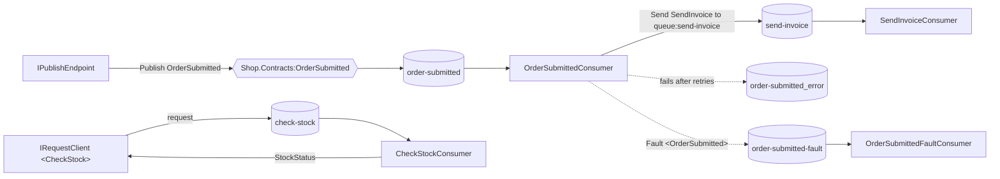

# 14 · MassTransit on RabbitMQ

The same ideas through a framework: events, commands, request/response, retries and faults.



## Run

```bash
dotnet run --project samples/14-MassTransit
```

## What the demo shows

* Request/response: `CheckStock` → `StockStatus` for two SKUs.
* A valid order is consumed and sends a `SendInvoice` command.
* An order over 10 000 EGP always throws: `UseMessageRetry(Intervals(100, 200, 400))` retries 3 times, then
  MassTransit moves it to `order-submitted_error` and publishes `Fault<OrderSubmitted>`.

## Compare with the raw client

| Raw RabbitMQ.Client (samples 01–13) | MassTransit |
|-------------------------------------|-------------|
| you declare exchanges/queues/bindings | `ConfigureEndpoints` creates them by convention |
| you serialise JSON and set properties | envelope with message id, correlation, types, headers |
| you build retries with DLX/TTL | `UseMessageRetry`, `UseDelayedRedelivery` |
| you build error queues | `_error` and `_skipped` queues, `Fault<T>` |
| RPC by hand (sample 07) | `IRequestClient<T>` |

Open http://localhost:15672 after running to see the topology MassTransit created.

> MassTransit 8.x is Apache 2.0 (pinned here). v9+ needs a commercial licence for production; see
> [doc 10](../../docs/10-dotnet-packages.md).
